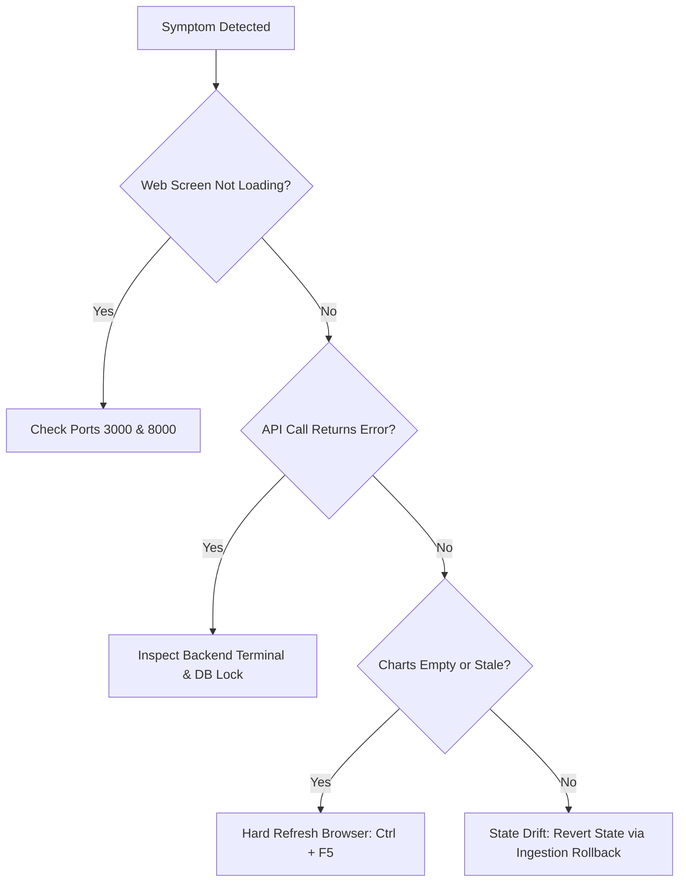

# SARAS ATLAS — Live Demonstration Troubleshooting & Incident Guide

**Platform:** SARAS ATLAS — Commerce Resilience & Decision Simulation Platform  
**Target Audience:** Technical Presenters, Solution Engineers, and DevOps Operators  
**Document Classification:** Operational Troubleshooting Manual  
**Release Version:** 6.0.0 | **Commit:** `686ebbf`  
**Execution Environment:** Local Windows Workstation (8 GB / 16 GB RAM Compatible, Offline, ₹0 Expenditure)

---

## 1. Quick Emergency Diagnostic Flowchart

If any anomaly occurs immediately before or during an executive demonstration, follow this rapid decision tree:



---

## 2. Common Scenarios & Instant Resolution Procedures

### Issue 1: Port Collision on Port 8000 (Backend) or Port 3000 (Frontend)

* **Symptom:**  
  `ERROR: [Errno 10048] error while attempting to bind on address ('127.0.0.1', 8000): only one usage of each socket address is normally permitted`  
  or Next.js starts on `http://localhost:3001` instead of `3000`.
* **Root Cause:**  
  A previous Node.js or Uvicorn process did not terminate cleanly and is holding the TCP socket.
* **Resolution (Execute in PowerShell):**
  ```powershell
  # Check for lingering processes on ports 8000 and 3000
  Get-NetTCPConnection -LocalPort 8000, 3000 -ErrorAction SilentlyContinue | Select-Object LocalPort, OwningProcess

  # Kill the offending process by PID (e.g. PID 12345)
  Stop-Process -Id <PID> -Force

  # Alternative: Kill all uvicorn and node instances
  Get-Process -Name "node", "python" -ErrorAction SilentlyContinue | Where-Object { $_.Path -like "*saras-atlas*" } | Stop-Process -Force
  ```

---

### Issue 2: Incorrect Python Version Resolution (Host Python Fragmentation)

* **Symptom:**  
  `ModuleNotFoundError: No module named 'fastapi'` or `ortools binary incompatibility` when running commands.
* **Root Cause:**  
  The host Windows machine contains multiple Python installations (Python 3.14 preview, Python 3.13 in Anaconda, and Python 3.12.10). Typing bare `python` may resolve to Python 3.14.
* **Resolution:**  
  Always execute within the isolated `.venv` using explicit relative or absolute paths:
  ```powershell
  # Explicit virtual environment activation
  cd C:\Users\DELL\.gemini\antigravity\scratch\saras-atlas
  .\.venv\Scripts\Activate.ps1

  # Verify Python executable path
  Get-Command python | Select-Object Source
  # Expected output: C:\Users\DELL\.gemini\antigravity\scratch\saras-atlas\.venv\Scripts\python.exe
  ```

---

### Issue 3: SQLite Database Locked Error (`sqlite3.OperationalError: database is locked`)

* **Root Cause:**  
  A transactional script or query held an exclusive write lock without closing the connection.
* **Prevention in ATLAS:**  
  ATLAS enforces Write-Ahead Logging (`PRAGMA journal_mode=WAL`), allowing simultaneous concurrent readers while writes execute.
* **Resolution (if lock persists):**
  ```powershell
  # 1. Check database WAL and shm files
  Get-ChildItem -Path "C:\Users\DELL\.gemini\antigravity\scratch\saras-atlas\data" -Filter "saras_atlas.db*"

  # 2. Run integrity check script
  C:\Users\DELL\.gemini\antigravity\scratch\saras-atlas\.venv\Scripts\python.exe -c "
  import sqlite3
  conn = sqlite3.connect('C:/Users/DELL/.gemini/antigravity/scratch/saras-atlas/data/saras_atlas.db')
  print('Integrity:', conn.execute('PRAGMA integrity_check').fetchone()[0])
  print('Journal:', conn.execute('PRAGMA journal_mode').fetchone()[0])
  conn.close()
  "
  ```

---

### Issue 4: Next.js Stale Client Cache or Turbopack Inconsistency

* **Symptom:**  
  Browser console shows `ChunkLoadError` or module components fail to refresh after hot reloading.
* **Resolution:**
  ```powershell
  cd C:\Users\DELL\.gemini\antigravity\scratch\saras-atlas\frontend

  # Stop frontend dev server (Ctrl + C)
  # Remove build cache
  Remove-Item -Recurse -Force .next -ErrorAction SilentlyContinue

  # Restart Next.js dev server
  npm run dev
  ```
  In browser: Press `Ctrl + Shift + R` (or `Ctrl + F5`) to force a hard cache refresh.

---

### Issue 5: CORS or Mixed-Host API Connection Failures

* **Symptom:**  
  Browser console shows `Access to fetch at 'http://127.0.0.1:8000/api/v1/health' from origin 'http://localhost:3000' has been blocked by CORS policy`.
* **Root Cause:**  
  Mismatch between `localhost` and `127.0.0.1` origins.
* **Verification in ATLAS:**  
  FastAPI backend explicitly configures permissive local CORS in `src/main.py`:
  ```python
  origins = [
      "http://localhost:3000",
      "http://127.0.0.1:3000",
      "http://localhost:8000",
      "http://127.0.0.1:8000",
  ]
  ```
* **Resolution:** Ensure the browser URL matches `http://localhost:3000`.

---

### Issue 6: Reverting Accidental Ingestion or Scenario State Drift

* **Symptom:**  
  During a live test, someone uploaded an experimental file or modified inventory data, and you want to restore the pristine Vanguard Apparel baseline before the executive walk-in.
* **Resolution:**
  ```powershell
  # Restore the database from the verified hot backup
  C:\Users\DELL\.gemini\antigravity\scratch\saras-atlas\.venv\Scripts\python.exe C:\Users\DELL\.gemini\antigravity\scratch\saras-atlas\scripts\backup_and_recovery.py --restore

  # Verify baseline record counts
  C:\Users\DELL\.gemini\antigravity\scratch\saras-atlas\.venv\Scripts\python.exe C:\Users\DELL\.gemini\antigravity\scratch\saras-atlas\scripts\verify_full_e2e_workflow.py
  ```

---

## 3. Clean Graceful Shutdown Protocol

At the conclusion of the executive demonstration, ensure zero background services remain running:

```powershell
# 1. Stop Next.js frontend terminal: Press Ctrl + C, then Y.
# 2. Stop Uvicorn backend terminal: Press Ctrl + C.

# 3. Verify ports 8000 and 3000 are completely free:
Get-NetTCPConnection -LocalPort 8000, 3000 -ErrorAction SilentlyContinue

# 4. Confirm zero background Python or Node daemons remain:
Get-Process -Name "node", "python" -ErrorAction SilentlyContinue | Where-Object { $_.Path -like "*saras-atlas*" }
```

Following this protocol guarantees a pristine, zero-overhead host environment adhering strictly to all project constraints.
