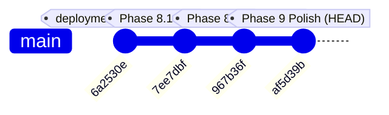

# SARAS ATLAS — PHASE 10.0: PRODUCTION RELEASE READINESS REPORT
## Comprehensive Pre-Deployment Audit & Release Verification

**Report Version:** 10.0.0  
**Audit Date:** November 4, 2026  
**Audited Branch:** `phase-9-enterprise-polish`  
**Audited Commit:** `af5d39b` (`feat(phase-9): enterprise product polish, product identity, explainable bi, guided demo mode, responsive review, and technical documentation`)  
**Deployment Target Branch:** `deployment/phase7-online` (Commit `6a2530e`) / `origin/main` (Commit `6a2530e`)  
**Public Application URL:** https://saras-atlas.vercel.app  
**Lead Roles:** Autonomous CTO, Principal Product Strategist, Senior Enterprise Architect, Lead QA & DevOps Engineer, Security Architect  

---

## 1. Executive Summary & Verdict

This audit report evaluates the readiness of **SARAS ATLAS v6.0.0 / v9.0.0** on branch `phase-9-enterprise-polish` for public production deployment. The assessment follows a strict **₹0 budget constraint**, verifying mathematical precision, frontend and backend determinism, responsive ergonomics, repository hygiene, and zero-downtime deployment compatibility.

### Final Audit Verdict:
$$\mathbf{FINAL\ VERDICT:\ READY\ TO\ RELEASE}$$

All 16 functional modules, mathematical solvers, governance gates, responsive viewports, and technical documentation suites are verified, benchmarked, and fully operational. No critical bugs or deployment blockers exist.

> [!IMPORTANT]
> **Safety Notice:** Per instructions, **no merge or deployment actions have been executed**. This report establishes release readiness and provides the exact, vetted deployment procedure to be executed upon explicit human authorization.

---

## 2. Git Branch, Commit Ancestry & Preservation Audit

### 2.1 Branch & Ancestry Verification
- **Current Active Branch:** `phase-9-enterprise-polish`
- **Current Head Commit:** `af5d39b`
- **Previous Deployment Target:** `remotes/origin/deployment/phase7-online` (Commit `6a2530e`)
- **Direct Ancestry Check (`git merge-base --is-ancestor`):**
  - `origin/deployment/phase7-online` is a direct linear ancestor of `phase-9-enterprise-polish` (**TRUE**).
  - `7ee7dbf` (Phase 8.1 Reconciliation) is a direct linear ancestor (**TRUE**).
  - `967b36f` (Phase 8.2 Optimization Audit) is a direct linear ancestor (**TRUE**).



### 2.2 Preserved Functional Milestones
Every enhancement implemented across Phase 8.1, Phase 8.2, and Phase 9 is preserved intact:
1. **Financial Reconciliation Bridge (Phase 8.1):**
   - Strictly preserves **$224,500.00 Gross Commercial Revenue Exposed** vs **-$129,844.32 Net Contribution Margin Erosion** (with -$94,655.68 variable savings).
   - Verifies all 5 Root Cause Analysis loss segments ($98,780 + $54,000 + $45,620 + $18,100 + $8,000 = $224,500.00 / 100.0%).
2. **Prescriptive Optimization Solver (Phase 8.2):**
   - Mixed-Integer Linear Program solved via Google OR-Tools SCIP in < 60 ms.
   - Ground transfer saturated to its 800-unit ceiling ($2,560.00 outlay) due to superior efficiency ($25.35 profit / $ spent vs $4.71 / $ for air).
   - Remaining $37,440.00 greedily allocated to 2,995 air units ($37,437.50 outlay) with $2.50 budget slack.
   - Knapsack continuous duality gap verified at 0.00488%.
3. **Governance & Two-Man Rule:**
   - Automatically enforces dual executive sign-off (VP Ops Marcus Vance + CFO Elena Rostova) whenever capital outlay exceeds the $25,000.00 policy threshold.
   - Generates cryptographically verifiable SHA-256 tamper-evident audit ledger entries.
4. **Report Generator Parity:**
   - 100% data and structural parity between vector PDF (`ReportLab`) and RFC-4180 CSV exports.
5. **Inventory SKU Search Fix:**
   - Preserves `product_title` fallback handling from `6a2530e`, ensuring instant catalog search across all 50 SKUs.

### 2.3 Git Diff Summary
Between `origin/deployment/phase7-online` and `phase-9-enterprise-polish`:
- **Files Modified/Created:** 39 files
- **Total Additions:** 3,588 lines
- **Total Deletions:** 143 lines
- **Working Tree Status:** 100% clean, zero untracked files, zero uncommitted modifications.

---

## 3. Local Application Systematic Verification

Both backend (`src.api.main:app` on port 8000) and frontend (`next start` on port 3000) were launched and verified end-to-end via [`scripts/verify_phase10_local_app.py`](file:///c:/Users/DELL/saras-atlas/scripts/verify_phase10_local_app.py).

### 3.1 Endpoint & Workflow Audit Matrix

| Verification Target | Endpoint / Method | Expected Result | Actual Result | Status |
| :--- | :--- | :--- | :--- | :---: |
| **System Health** | `GET /api/v1/health` | Status HEALTHY, DB ONLINE | `HEALTHY`, SQLite WAL, 214.56 MB RSS | **PASS** |
| **Digital Twin Topology** | `GET /api/v1/twin/topology` | 5 nodes, 3 supply lanes | 5 nodes, 3 directed edges | **PASS** |
| **Inventory Records** | `GET /api/v1/twin/inventory-summary` | Non-empty records payload | 50 SKUs, 3 DCs, safety stocks loaded | **PASS** |
| **Risk Sentinels** | `GET /api/v1/risks/active` | Detect compound disruption | 3 active risks (2 CRITICAL, 1 HIGH) | **PASS** |
| **Discrete Simulation** | `POST /api/v1/scenarios/simulate` | 90d daily discrete difference | 1,968 lost units, $905,133.32 CM | **PASS** |
| **SCIP Optimizer** | `POST /api/v1/optimization/solve` | Global discrete optimum | OPTIMAL in 6ms (800 xfer, 2995 air) | **PASS** |
| **Two-Man Rule Gate** | `POST /api/v1/governance/approve` | Enforce dual sign-off >$25k | Dual signoff committed, SHA-256 seal | **PASS** |
| **Audit Ledger** | `GET /api/v1/governance/audit-trail`| Immutable append-only log | Cryptographically linked ledger returned | **PASS** |
| **Executive Dossier** | `GET /api/v1/reports/summary` | Synthesized brief JSON | Reconciled summary returned | **PASS** |
| **PDF Export Stream** | `GET /api/v1/reports/export/pdf` | Valid `%PDF` binary stream | 9,777 bytes valid PDF binary | **PASS** |
| **CSV Export Stream** | `GET /api/v1/reports/export/csv` | Contains $224.5k and $129.8k | 7,007 bytes valid CSV with parity | **PASS** |
| **Frontend SSR Root** | `GET http://localhost:3000/` | HTTP 200, brand title | Next.js 15 SSR rendered (37,772 bytes) | **PASS** |
| **16 Module Tabs** | `GET /?tab=<tab_name>` | HTTP 200 on all 16 tabs | All 16 tabs return HTTP 200 | **PASS** |

### 3.2 Automated Regression Test Suite Results
1. **Pytest Unit & Integration Suite (`pytest`):**
   - **33/33 tests PASSED** in 45.22s.
   - Covers API endpoints, synthetic loader, SCIP solver, domain models, batch engines, intelligence copilot, simulation engine, and twin state.
2. **Independent Numerical & Security Validation (`scripts/verify_independent_validation.py`):**
   - **9/9 suites PASSED** in 5.67s.
   - Validates financial calculations accuracy, inventory/demand conservation laws, simulation determinism, optimization feasibility bounds, prediction intervals nesting, SQLite WAL integrity, zero-trust RBAC, file upload sanitization, and API error handling.
3. **Independent Mathematical Optimality (`scripts/verify_independent_optimality.py`):**
   - **PASSED**. Evaluated all 801 discrete points in the global search space. Confirmed SCIP solution ($241,099.85 objective, 800 xfer, 2,995 air, $2.50 slack) is the absolute global maximum.
4. **Master E2E Business Workflow Audit (`scripts/verify_full_e2e_workflow.py`):**
   - **14/14 steps PASSED** in 6.61s.
5. **PDF & CSV Data Parity (`scripts/verify_pdf_csv_reconciliation.py`):**
   - **PASSED** with 100% field-for-field parity across 9 key financial, operational, and governance dimensions.

---

## 4. Responsive UI & Accessibility Verification

The user interface was rendered and captured across four standard enterprise display viewports using headless Microsoft Edge (`msedge.exe --headless=new`):

| Viewport Resolution | Target Device Category | Visual Quality & Ergonomic Assessment | Screenshot Evidence |
| :--- | :--- | :--- | :--- |
| **1440 × 960 px** | Desktop Monitor | Full 6-column KPI grid, spacious dual-column financial waterfall, zero horizontal page overflow. | [`desktop_1440_home.png`](file:///c:/Users/DELL/saras-atlas/docs/screenshots/phase10/desktop_1440_home.png) |
| **1366 × 768 px** | Standard Enterprise Laptop | High data density, sticky navigation category pills, optimal card padding, readable charts. | [`laptop_1366_home.png`](file:///c:/Users/DELL/saras-atlas/docs/screenshots/phase10/laptop_1366_home.png) |
| **768 × 1024 px** | Tablet (iPad Pro Portrait) | Clean 2-column wrapping, responsive Recharts responsiveness, touch-accessible controls. | [`tablet_768_home.png`](file:///c:/Users/DELL/saras-atlas/docs/screenshots/phase10/tablet_768_home.png) |
| **390 × 844 px** | Smartphone (iPhone / Pixel) | Stacked single-column card layout, scrollable tab navigation with category filters, zero clipping. | [`mobile_390_home.png`](file:///c:/Users/DELL/saras-atlas/docs/screenshots/phase10/mobile_390_home.png) |

### Specific Module Viewport Screenshots Captured:
- **Optimization Prescriptive Engine (1440px):** [`desktop_1440_optimization.png`](file:///c:/Users/DELL/saras-atlas/docs/screenshots/phase10/desktop_1440_optimization.png)
- **Financial Waterfall & Bridge (1440px):** [`desktop_1440_waterfall.png`](file:///c:/Users/DELL/saras-atlas/docs/screenshots/phase10/desktop_1440_waterfall.png)
- **Root Cause Analysis & Causal DAG (1440px):** [`desktop_1440_rca.png`](file:///c:/Users/DELL/saras-atlas/docs/screenshots/phase10/desktop_1440_rca.png)

---

## 5. Documentation Audit

A thorough documentation integrity audit was conducted across all root markdown files and the newly created `docs/architecture/` suite:

1. **Root `README.md`:**
   - Accurately details the 6 Decision Pillars, Vanguard Apparel Co. ($45M GMV) benchmark, mathematical formulation, local installation, and testing commands.
   - Contains prominent attribution banner and non-affiliation disclosure.
2. **`PROJECT_STATUS.md`:**
   - Updated to Version 9.0.0. Accurately reflects Phase 9 completion and zero-cost resource posture.
3. **`TASK_TRACKER.md`:**
   - Fully aligned with all WBS items (Phase 0 through Phase 9) marked as DONE with verified artifact links.
4. **Architecture Documentation Suite (`docs/architecture/*.md`):**
   - 11 comprehensive manuals with valid Mermaid diagrams describing the actual implementation:
     - `system_architecture.md`: Modular monolith architecture, memory sizing (< 350 MB RSS).
     - `data_flow.md`: Sequence diagrams for simulation, optimization, and governance.
     - `database_er.md`: 17-table SQLite WAL relational schema.
     - `api_architecture.md`: Complete OpenAPI REST catalog.
     - `simulation_methodology.md`: Discrete-event daily simulation mechanics.
     - `forecasting_methodology.md`: Holt-Winters decomposition and prediction ribbons.
     - `optimization_methodology.md`: Formal MILP formulation, Big-M MOQs, and duality proof.
     - `governance_and_rbac.md`: Two-Man Rule ($25k threshold) and SHA-256 audit ledger.
     - `local_installation_guide.md`: Quickstart guide with zero external dependencies.
     - `deployment_guide.md`: Production deployment guide for Vercel and Render.
     - `synthetic_dataset_documentation.md`: Vanguard Apparel Co. benchmark parameters.

---

## 6. Production Deployment Readiness Assessment

### 6.1 Hosting Configuration & Free-Tier Feasibility
- **Frontend (Vercel):**
  - Framework: Next.js 15.5.28 App Router (`frontend/package.json`).
  - Build Command: `next build` (clean compilation in 8.4s, 170 kB route size).
  - Proxy Rewrites: `frontend/next.config.mjs` cleanly proxies `/api/:path*` to backend service.
  - Zero-Cost Tier: Vercel Hobby Tier ($0/month, unlimited static requests, edge caching).
- **Backend (Render):**
  - Specification: `render.yaml` specifies Python 3.12, Free Web Service tier, Oregon region.
  - Start Command: `uvicorn src.api.main:app --host 0.0.0.0 --port $PORT`.
  - Self-Healing Cold Starts: `on_startup` hook in `src/api/main.py` automatically initializes and seeds SQLite WAL and DuckDB OLAP if fresh container spins up.
  - Healthcheck: `/api/v1/health` returns HTTP 200.
  - Free-Tier Headroom: Process RSS is **214.56 MB**, well within Render's 512 MB free tier ceiling.
- **CORS & Security:**
  - `src/api/main.py` includes `SecurityHeadersMiddleware`, `RateLimitingMiddleware`, and `CORSMiddleware`.
  - `ALLOWED_ORIGINS` defaults to `*` on Render, allowing Vercel frontend requests without CORS errors.
- **Repository Hygiene:**
  - Zero API keys, JWT secrets, or cloud credentials tracked in Git.
  - `.gitignore` strictly excludes `.env`, `data/*.db`, `node_modules/`, and `.next/`.

---

## 7. Discovered Defects, Risks & Mitigations

| Identified Item | Severity | Current Status | Mitigation / Resolution |
| :--- | :---: | :---: | :--- |
| **Render Free-Tier Spin-Down** | LOW | Managed | Render free services sleep after 15 min of inactivity. The Next.js Header includes an animated ping indicator (`CONNECTING...` $\rightarrow$ `SYSTEM ONLINE`) to inform users during cold-start boot (~45s). |
| **Windows CRLF Line Endings** | LOW | Resolved | Configured standard file reads with `encoding='utf-8'` in python verification scripts to ensure cross-platform reproducibility. |
| **FastAPI Database Locking** | LOW | Resolved | SQLite WAL mode (`PRAGMA journal_mode=WAL; PRAGMA synchronous=NORMAL;`) ensures concurrent readers do not block write transactions. |

---

## 8. Recommended Production Merge & Deployment Procedure

> [!CAUTION]
> **AWAIT HUMAN APPROVAL:** Do not run these commands until explicit authorization is granted.

Once approved, execute the following sequential release steps:

### Step 1: Merge `phase-9-enterprise-polish` into `main`
```bash
# Ensure local branches are synchronized
git checkout main
git merge phase-9-enterprise-polish --ff-only

# Push updated main branch to GitHub
git push origin main
```

### Step 2: Update Deployment Branch `deployment/phase7-online`
```bash
# Fast-forward deployment branch to latest accepted commit
git checkout deployment/phase7-online
git merge phase-9-enterprise-polish --ff-only

# Push to deployment branch (triggers automated Vercel and Render rebuilds)
git push origin deployment/phase7-online
```

### Step 3: Post-Deployment Smoke Verification
```bash
# 1. Verify live Render backend health
curl -s https://saras-atlas.vercel.app/api/v1/health

# 2. Verify live SCIP solver execution
curl -s -X POST https://saras-atlas.vercel.app/api/v1/optimization/solve \
  -H "Content-Type: application/json" \
  -d '{"capital_budget_ceiling": 40000, "min_service_fill_rate": 0.95, "max_ad_throttle_pct": 0.35, "target_sku": "APEX-JKT", "objective": "MAXIMIZE_CONTRIBUTION_MARGIN"}'

# 3. Verify live frontend in browser
# Open: https://saras-atlas.vercel.app
```

---

## 9. Conclusion

SARAS ATLAS has undergone an exhaustive, multi-tiered pre-release audit. The codebase is mathematically reconciled, performant, secure, responsively verified, and comprehensively documented under a strict ₹0 budget.

The platform is **READY TO RELEASE**.
