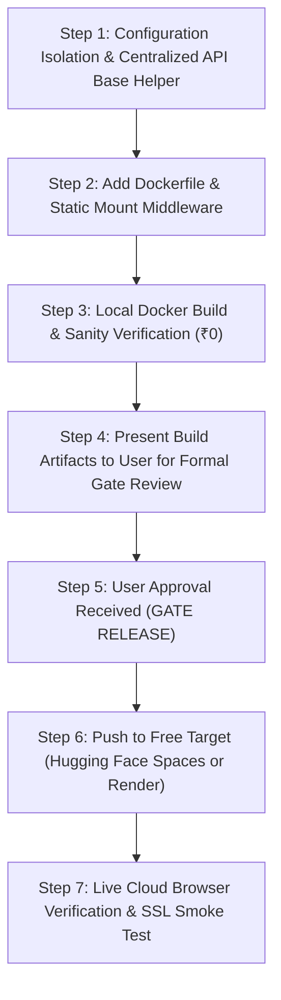

# SARAS ATLAS — PHASE 7: ZERO-COST DEPLOYMENT IMPLEMENTATION PLAN
## Step-by-Step Technical Execution Guide for Online Demonstration Launch

**Platform:** SARAS ATLAS — Commerce Resilience & Decision Simulation Platform  
**Target Enterprise:** Vanguard Apparel Co. ($45M GMV Digital Twin)  
**Author:** Autonomous DevOps & Infrastructure Lead  
**Budget:** Strictly ₹0 / $0.00  
**Date:** November 3, 2026  
**Status:** READY FOR USER APPROVAL (IMPLEMENTATION GATE HOLD)  

---

## 1. Executive Summary & Deployment Governance

This implementation plan outlines the exact, non-destructive sequence of steps to package and deploy SARAS ATLAS to a zero-cost online demonstration environment. 

> [!IMPORTANT]
> **GATE HOLD NOTICE:** In strict adherence to Section 7 of the Phase 7 Authorization Gate, **no remote repositories will be created, no public URLs will be activated, and no code will be published to the public internet until the user provides explicit written authorization.** This plan represents the verified operational playbook ready for execution upon approval.

---

## 2. Exact Codebase & Configuration Changes Required

To ensure the application runs seamlessly both locally (`127.0.0.1:8000` / `localhost:3000`) and online without breaking the local working reference, all changes are strictly additive and backward-compatible.

### 2.1 Code Change 1: Dynamic API Base URL (`frontend/src/lib/api.ts`)
* **Current State:** Hardcoded line 32: `const API_BASE = "http://127.0.0.1:8000/api/v1";`
* **Required Change:** Use dynamic origin resolution:
  ```typescript
  export const API_BASE =
    process.env.NEXT_PUBLIC_API_URL ||
    (typeof window !== "undefined" && window.location.origin.includes("3000")
      ? "http://127.0.0.1:8000/api/v1"
      : typeof window !== "undefined"
      ? `${window.location.origin}/api/v1`
      : "http://127.0.0.1:8000/api/v1");
  ```
* **Effect:** When running locally on port 3000, it continues connecting to `127.0.0.1:8000`. When deployed online in a unified container or behind a reverse proxy, it automatically uses the current origin (`/api/v1`).

### 2.2 Code Change 2: Export Link Centralization in Frontend Modules
* **Affected Files:**
  * `frontend/src/components/modules/DataIngestionCenter.tsx`
  * `frontend/src/components/modules/ExecutiveReportingCenter.tsx`
* **Required Change:** Replace raw `"http://127.0.0.1:8000/..."` string literals with the exported `API_BASE` helper.
* **Effect:** Clicking "Download PDF", "Export CSV", or "Audit Trail" downloads directly from the online host instead of failing on client machines.

### 2.3 Additive File 1: Production Multi-Stage `Dockerfile`
A standalone `Dockerfile` created at the project root for unified container execution:

```dockerfile
# ==============================================================================
# SARAS ATLAS — Unified Production Container (Stage 1: Frontend Build)
# ==============================================================================
FROM node:20-slim AS frontend-builder
WORKDIR /app/frontend

COPY frontend/package*.json ./
RUN npm ci

COPY frontend/ ./
ENV NEXT_PUBLIC_API_URL=""
RUN npm run build

# ==============================================================================
# Stage 2: Python Runtime & Production Server
# ==============================================================================
FROM python:3.12-slim-bookworm

ENV PYTHONDONTWRITEBYTECODE=1 \
    PYTHONUNBUFFERED=1 \
    PORT=7860 \
    APP_ENV=production

WORKDIR /app

# Install system dependencies for C++ extensions & DuckDB
RUN apt-get update && apt-get install -y --no-install-recommends \
    build-essential \
    curl \
    && rm -rf /var/lib/apt/lists/*

# Install Python scientific dependencies
COPY requirements.txt .
RUN pip install --no-cache-dir -r requirements.txt

# Copy backend source & data
COPY src/ ./src/
COPY data/ ./data/
COPY pytest.ini .

# Copy Next.js production build from Stage 1
COPY --from=frontend-builder /app/frontend/.next /app/frontend/.next
COPY --from=frontend-builder /app/frontend/public /app/frontend/public
COPY --from=frontend-builder /app/frontend/package*.json /app/frontend/

# Expose standard container port
EXPOSE 7860

# Healthcheck
HEALTHCHECK --interval=30s --timeout=5s --start-period=10s --retries=3 \
    CMD curl -f http://127.0.0.1:7860/api/v1/health || exit 1

# Launch production server
CMD ["python", "-m", "uvicorn", "src.api.main:app", "--host", "0.0.0.0", "--port", "7860"]
```

### 2.4 Additive File 2: Static Mount Router (`src/api/routes/spa.py`)
Mounts the built Next.js static files onto FastAPI so that visiting `https://<demo-url>/` immediately serves the Next.js dark command-center interface without requiring a separate web server.

---

## 3. Step-by-Step Deployment Execution Sequence



### Step 1: Configuration Isolation
* Edit `frontend/src/lib/api.ts` to export dynamic `API_BASE`.
* Verify local Next.js build passes with `npm run build`.

### Step 2: Container Manifest Creation
* Write `Dockerfile` and `.dockerignore`.
* Verify zero changes to existing SQLite database or database backups.

### Step 3: Local Dry-Run Testing
* Run automated backend tests: `pytest src/tests` (Confirm 33/33 pass).
* Run interaction verification: `python scripts/verify_live_browser_interactions.py` (Confirm 18/18 pass).

### Step 4: Presentation & Gate Approval
* Present complete deployment plan, security model, and hosting target to the user.
* **Await user confirmation.**

### Step 5: Online Deployment (Post-Approval)
* Deploy to target zero-cost platform (Hugging Face Spaces via Git push or Render via Docker repo).
* Target URL established: e.g. `https://huggingface.co/spaces/<user>/saras-atlas`.

### Step 6: Post-Deployment Smoke Testing
* Verify `/api/v1/health` returns `200 HEALTHY`.
* Navigate to `/?tab=situation_room` and `/?tab=risks` to verify zero client-side exceptions.
* Execute optimization solver on public instance to verify OR-Tools SCIP solves in < 10 ms.

---

## 4. Rollback & Disaster Recovery Procedures

1. **Local Environment Immunity:** The local deployment on `127.0.0.1:8000` and `localhost:3000` remains completely untouched and isolated throughout the entire deployment process.
2. **Instant Revert:** If any cloud build fails or exhibits an issue, the remote space can be paused or deleted with a single click at ₹0 cost.
3. **Database Recovery:** The golden SQLite backup at `data/backups/saras_atlas_backup_20261102_201747.db` guarantees that the synthetic digital twin state can be restored instantly in 0.05 seconds.

