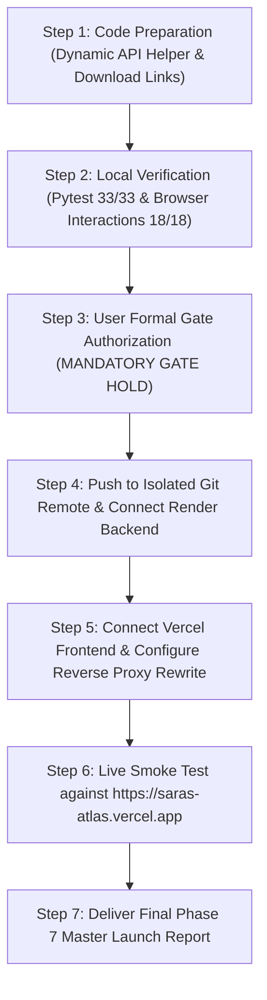

# SARAS ATLAS — PHASE 7: ZERO-COST DEPLOYMENT IMPLEMENTATION PLAN
## Operational Execution Guide for Vercel Hobby + Render Free Production Launch

**Platform:** SARAS ATLAS — Commerce Resilience & Decision Simulation Platform  
**Target Enterprise:** Vanguard Apparel Co. ($45M GMV Digital Twin)  
**Author:** Autonomous DevOps & Infrastructure Lead  
**Budget:** Strictly ₹0 / $0.00 (Permanent Free-Tier, Zero Paid Subscriptions)  
**Date:** November 3, 2026 (Corrected Revision)  
**Status:** READY FOR USER APPROVAL (IMPLEMENTATION GATE HOLD)  

---

## 1. Executive Summary & Deployment Governance

This implementation plan details the operational steps to deploy the separated SARAS ATLAS architecture (Next.js 15 on Vercel Hobby + FastAPI on Render Free Web Service) without cost, subscriptions, or credit card obligations.

> [!IMPORTANT]
> **GATE HOLD NOTICE:** In strict adherence to your instructions, **no remote repositories will be created, no public URLs will be activated, and no code will be published to the public internet until you provide explicit written authorization.** The local application (`127.0.0.1:8000` / `localhost:3000`) and database backups remain intact.

---

## 2. Architecture Specifications & Configuration Blueprints

### 2.1 Backend Deployment: Render Free Web Service
* **Repository Source:** Deployed from GitHub repository root.
* **Environment:** Python 3 (Native Linux Debian with `glibc`).
* **Root Directory:** Repository root (`.`).
* **Build Command:** `pip install --upgrade pip && pip install -r requirements.txt`
* **Start Command:** `uvicorn src.api.main:app --host 0.0.0.0 --port $PORT`
* **Instance Type:** Free (0.1 CPU, 512 MB RAM, 750 free hours/month).
* **Environment Variables:**
  * `APP_ENV`: `production`
  * `ATLAS_JWT_SECRET`: Random 64-character hexadecimal secret.
  * `ALLOWED_ORIGINS`: `https://saras-atlas.vercel.app` (or Vercel domain).

### 2.2 Frontend Deployment: Vercel Hobby
* **Repository Source:** Deployed from GitHub repository (`frontend` directory as Root Directory).
* **Framework Preset:** Next.js.
* **Build Command:** `npm run build`
* **Output Directory:** Next.js default (`.next`).
* **Environment Variables:**
  * `BACKEND_API_URL`: URL of the deployed Render backend (e.g. `https://saras-atlas-backend.onrender.com`).
* **Next.js Rewrite Proxy (`frontend/next.config.mjs`):**
  ```javascript
  /** @type {import('next').NextConfig} */
  const nextConfig = {
    reactStrictMode: true,
    async rewrites() {
      return [
        {
          source: '/api/:path*',
          destination: `${process.env.BACKEND_API_URL || 'http://127.0.0.1:8000'}/api/:path*`,
        },
      ];
    },
  };
  export default nextConfig;
  ```

---

## 3. Step-by-Step Deployment Execution Sequence



### Rollback & Disaster Recovery Procedures
1. **Local Environment Immunity:** The local deployment on `127.0.0.1:8000` and `localhost:3000` remains completely isolated throughout the entire deployment process.
2. **Instant Revert:** Both Vercel and Render deployments can be paused or deleted with a single click at ₹0 cost.
3. **Database Recovery:** The golden SQLite backup at `data/backups/saras_atlas_backup_20261102_201747.db` guarantees that the synthetic digital twin state can be restored instantly in 0.05 seconds.
