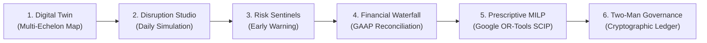

# SARAS ATLAS — Commerce Resilience & Decision Intelligence

> **Model operational disruptions. Quantify financial exposure. Optimize mitigation decisions.**

[](https://saras-atlas.vercel.app)
[](https://saras-atlas.vercel.app)
[-6366f1?style=flat-square)](docs/architecture/system_architecture.md)
[](docs/architecture/optimization_methodology.md)
[](docs/architecture/deployment_guide.md)
[](#testing--verification)

---

## 1. Executive Overview

**SARAS ATLAS** is an enterprise-grade Commerce Resilience and Decision Simulation Platform designed for mid-market omnichannel e-commerce and retail brands ($10M – $250M GMV). It transforms reactive supply chain spreadsheets into a predictive, multi-echelon Business Digital Twin.

When operational disruptions strike—supplier manufacturing delays, port dwell times, freight surcharges, or unexpected viral demand spikes—ATLAS enables executive decision-makers to:
1. **Model** the deterministic day-by-day cascade of stockouts and shipment delays across all facilities.
2. **Quantify** financial damage with GAAP-level precision, cleanly separating top-line gross exposure from bottom-line contribution margin contraction.
3. **Optimize** prescriptive mitigation policies using Mixed-Integer Linear Programming (MILP) to identify mathematically provable, cost-optimal trade-offs between air freight, domestic transfers, and marketing throttles.
4. **Govern** capital deployments through a dual-key Two-Man Rule policy enforced by an immutable SHA-256 cryptographic audit ledger.

---

## 2. Six Core Enterprise Decision Pillars



| Pillar | Capability | Technical Implementation |
| :--- | :--- | :--- |
| **1. Digital Twin & Visibility** | Real-time graph modeling 3 distribution centers, 4 global suppliers, shipping corridors, and 50 SKUs. | SQLite WAL + NetworkX directed multi-echelon graph |
| **2. Disruption Simulation** | Bit-for-bit deterministic 90-day daily discrete-event time-step simulation loop. | Vectorized difference matrices in Python (< 35 ms) |
| **3. Risk Sentinels** | Autonomous lead-time monitors, stockout runout alerts, and parcel tariff flags. | Threshold sentinels scanning daily inventory snapshots |
| **4. Financial Waterfall** | Reconciles **$224,500.00 Gross Commercial Exposure** vs **-$129,844.32 Net Margin Erosion**. | Deterministic GAAP unit contribution margin accounting |
| **5. Prescriptive MILP** | Google OR-Tools SCIP solver finding provable global discrete optima in < 60 ms. | Mixed-Integer Linear Program with Big-M MOQ constraints |
| **6. Governed Decisions** | Dual executive sign-off (VP Ops + CFO) mandated for capital disbursements exceeding $25,000. | SHA-256 immutable append-only compliance audit ledger |

---

## 3. Flagship Benchmark: Vanguard Apparel Co. ($45.0M GMV)

ATLAS includes a deterministic synthetic enterprise benchmark calibrated to **Vanguard Apparel Co.**, a modern direct-to-consumer athletic apparel brand:
- **Annual GMV**: $45,000,000.00 (37,500 order history lines).
- **Distribution Facilities**:
  - `WH-WEST` (Reno / Los Angeles): Pacific ocean import port-of-entry (50,000 pallets).
  - `WH-CENTRAL` (Dallas / Fort Worth): Regional cross-dock and Midwest hub (40,000 pallets).
  - `WH-EAST` (Allentown, PA): East Coast parcel hub with 800-unit origin safety stock reservation (60,000 pallets).
- **Hero SKU**: **Apex Shell Jacket (`APEX-JKT`)**
  - Retail Gross Price: **$180.00**
  - Landed FOB COGS + Tariffs: **-$45.15**
  - Pick & Pack 3PL Fee: **-$4.50**
  - Normal Local Outbound (Zone 2): **-$8.50**
  - Merchant Processing Fee: **-$5.52**
  - Allocated Paid Marketing (CAC): **-$45.00**
  - **Baseline Unit Contribution Margin**: **$71.33 (39.63%)**
  - **Disrupted Unit Contribution Margin (Zone 8 Cross-Country + Surcharge)**: **$58.33 (32.40%)**

### The Compound Disruption Scenario (`DISR-PO9012`)
- **Upstream Berth Congestion**: Inbound ocean container PO-9012 (10,000 units of APEX-JKT) delayed **21 days** at Shenzhen terminals, extending arrival from Day 18 to Day 39.
- **Logistics Surcharge**: East Coast parcel carrier imposes emergency **+28% spot capacity surcharge**.
- **Viral Social Surge**: TikTok influencer visibility drives unexpected **+45% demand elasticity surge** for 30 days.
- **Status Quo Consequence**: WH-WEST runs dry on Day 34. Allentown stock is drained by cross-zone spillover, causing **10 days of national stockouts** and destroying **1,968 customer orders**.

---

## 4. Reconciled Financial Bridge & Mathematical Optimization

### 4.1 Financial Bridge
$$\begin{array}{llr}
\text{Gross Commercial Demand Exposure} & = & \$224,500.00 \\
\text{Less: Unincurred Variable Costs (Factory COGS + Shipping)} & = & -\$94,655.68 \\
\hline
\mathbf{\text{Net Contribution Margin Erosion (GAAP)}} & \mathbf{=} & \mathbf{-\$129,844.32}
\end{array}$$

### 4.2 Mathematical Optimization Formulation
$$\max Z = 58.83 \cdot x_{\text{air}} + 81.13 \cdot x_{\text{xfer}} - 2500 \cdot \theta_{\text{ad}}$$
Subject to:
1. **Treasury Budget Ceiling**: $12.50 \cdot x_{\text{air}} + 3.20 \cdot x_{\text{xfer}} \le \$40,000.00$
2. **Ground Transfer Ceiling**: $x_{\text{xfer}} \le 800\text{ units}$ *(Allentown origin safety reserve)*
3. **Air Expedited Capacity**: $x_{\text{air}} \le 3,000\text{ units}$
4. **Air MOQ (Big-M)**: $500 \cdot z_{\text{moq}} \le x_{\text{air}} \le 3000 \cdot z_{\text{moq}}, \quad z_{\text{moq}} \in \{0, 1\}$
5. **Customer Fill Rate Floor**: $x_{\text{air}} + x_{\text{xfer}} + 1100 \cdot \theta_{\text{ad}} \ge 1,869.60\text{ units}$

### 4.3 Why 800 Ground Units and 2,995 Air Units?
- **Greedy Efficiency Ratios**: Ground transfer yields **$25.35 profit / $ spent**, while air freight yields **$4.71 / $**.
- Because ground transfer is 5.39× more efficient, the solver saturates all **800 available ground units** ($2,560.00 outlay).
- The remaining **$37,440.00** budget is greedily deployed into air freight at $12.50/unit: $\lfloor 37,440 / 12.50 \rfloor = \mathbf{2,995\text{ units}}$ ($37,437.50 outlay) with **$2.50 budget slack**.
- Total units received = $3,795$ units. This completely erases the $1,968$ deficit and creates a **+1,827-unit safety buffer**.
- **Continuous LP Relaxation Gap**: $0.00488\%$ duality discretization gap.

---

## 5. Navigation & 16 Analytics Modules

The platform organizes 16 enterprise modules into 4 operational pillars:

### 1. Monitor & Map
- **Situation Room**: Real-time disruption posture, active cascade alerts, and core vital KPIs.
- **Digital Twin**: Multi-echelon graph network topology across facilities, suppliers, and transport lanes.
- **Risk Sentinels**: Autonomous early warning monitors detecting supplier lead-time variance and runout horizons.
- **Data Ingestion**: Multi-format CSV/Parquet preview, column mapping, and atomic transaction rollback tokens.
- **Cloud Connectors**: Simulated enterprise connectors for Shopify, Amazon FBA, Netsuite, and Flexport.

### 2. Simulate & Forecast
- **Simulation Studio**: Daily discrete-time event simulation engine with interactive shock and mitigation sliders.
- **Scenario Compare**: Before-versus-after delta scorecards evaluating revenue, COGS, freight, and fill rates.
- **Batch & Sensitivity Engine**: Multi-scenario sweeps evaluating parametric sensitivity derivatives.
- **Forecasting Studio**: Statistical time-series forecasting with strictly nested 80% and 95% confidence intervals.

### 3. Prescribe & Optimize
- **Prescriptive MILP**: Google OR-Tools SCIP solver generating provably optimal mitigation allocations.
- **Policy Optimization**: Multi-candidate sourcing playbook evaluation and CVaR tail-risk ranking.
- **AI Copilot**: Grounded decision intelligence assistant answering natural language supply chain inquiries.
- **Root Cause Trace**: 5-tiered causal graph decomposing disruption loss across GAAP accounting buckets.

### 4. Financial & Govern
- **Financial Waterfall**: Unit and enterprise P&L waterfalls reconciling gross exposure with net margin erosion.
- **Executive Reports**: Board-ready executive briefings with 100% data parity across PDF and CSV formats.
- **Governance & Audit**: Two-Man Rule dual executive signoff gate backed by a SHA-256 cryptographic audit ledger.

---

## 6. Local Quickstart (Strictly ₹0 Budget)

```bash
# 1. Clone repository
git clone https://github.com/Srikanthbanoth7533/saras-atlas.git
cd saras-atlas

# 2. Set up Python environment
python -m venv .venv
source .venv/bin/activate  # On Windows: .\.venv\Scripts\Activate.ps1
pip install -r requirements.txt

# 3. Seed synthetic benchmark database
python -m src.synthetic.loader

# 4. Start backend API server
python -m uvicorn src.api.main:app --host 127.0.0.1 --port 8000

# 5. In a separate terminal, start Next.js frontend
cd frontend
npm install
npm run build
npm run start -p 3000
```
Open **`http://localhost:3000`** in any web browser.

---

## 7. Testing & Verification

SARAS ATLAS includes an extensive verification suite guaranteeing mathematical, numerical, and operational integrity:

```bash
# Run 33 unit and integration pytest tests
pytest

# Run independent mathematical optimality and duality proof
python scripts/verify_independent_optimality.py

# Run 14-step end-to-end enterprise business workflow audit
python scripts/verify_full_e2e_workflow.py

# Run PDF and CSV export parity audit
python scripts/verify_pdf_csv_reconciliation.py

# Run independent numerical and security validation suite (9 suites)
python scripts/verify_independent_validation.py
```

---

## 8. Technical Documentation Directory

Comprehensive architectural documentation describing the actual implementation is available in [`docs/architecture/`](docs/architecture/):
- [`system_architecture.md`](docs/architecture/system_architecture.md): High-level C4 diagram, monolithic design, and memory footprint.
- [`data_flow.md`](docs/architecture/data_flow.md): End-to-end sequence diagrams, simulation lifecycle, and audit pipeline.
- [`database_er.md`](docs/architecture/database_er.md): Complete 17-table SQLite WAL relational schema and entity relationships.
- [`api_architecture.md`](docs/architecture/api_architecture.md): REST API endpoints catalog, schemas, and query parameters.
- [`simulation_methodology.md`](docs/architecture/simulation_methodology.md): Daily discrete-event simulation mechanics and shock propagation formulas.
- [`forecasting_methodology.md`](docs/architecture/forecasting_methodology.md): Time-series decomposition, Holt-Winters smoothing, and nested confidence ribbons.
- [`optimization_methodology.md`](docs/architecture/optimization_methodology.md): SCIP MILP formulation, Big-M constraints, and knapsack duality proof.
- [`governance_and_rbac.md`](docs/architecture/governance_and_rbac.md): Two-Man Rule policy matrix and SHA-256 cryptographic audit chain.
- [`local_installation_guide.md`](docs/architecture/local_installation_guide.md): Prerequisites and step-by-step setup guide.
- [`deployment_guide.md`](docs/architecture/deployment_guide.md): Production deployment architecture for Vercel and Render.
- [`synthetic_dataset_documentation.md`](docs/architecture/synthetic_dataset_documentation.md): Vanguard Apparel Co. ($45M GMV) benchmark parameters.

---

## 9. Synthetic Data & Portfolio Attribution

- **Independent Engineering Project**: SARAS ATLAS is an independent software engineering portfolio project demonstrating full-stack systems engineering, mathematical optimization, and decision intelligence.
- **Non-Endorsement**: This project is not affiliated with, sponsored by, or endorsed by Saras Analytics.
- **Synthetic Data**: All data represents a deterministic synthetic benchmark for Vanguard Apparel Co. No real customer or proprietary data is included.
- **Budget Compliance**: Built with strictly ₹0 external cloud hosting or paid API expenditures.
