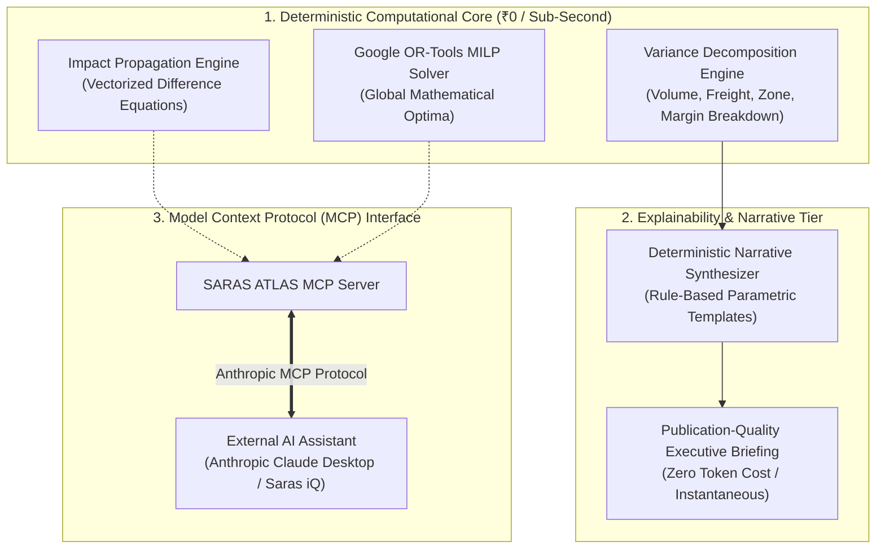

# AI AGENT ARCHITECTURE & EXPLAINABILITY SPECIFICATION

**Document ID:** AI-ATLAS-001  
**Version:** 1.0.0  
**Phase:** Phase 0 Baseline  
**Author:** AI/ML Research Engineer & Principal Enterprise Architect  

---

## 1. Architectural Philosophy: The Deterministic Foundation

The fundamental thesis of SARAS ATLAS is that **commercial and financial simulation must be mathematically deterministic**. 

Many modern "AI agent" platforms fail in commercial environments because they delegate calculations to Large Language Models (LLMs). LLMs:
1. Hallucinate arithmetic, generating plausible-sounding but mathematically false profit and inventory numbers.
2. Cannot solve mixed-integer linear optimization models or guarantee constraint satisfaction.
3. Are non-reproducible, returning different answers to identical operational inputs.
4. Are financially expensive, incurring unpredictable token billing.
5. Incur high latency (often 5 to 30 seconds per query).

In SARAS ATLAS, **zero arithmetic, zero inventory propagation, and zero optimization is executed by an LLM**. The mathematical core is 100% deterministic. The role of AI is strictly partitioned into **Synthesizing Executive Explanations** and providing **Conversational Tool Access** via standardized protocols.



---

## 2. Deterministic Narrative Synthesizer & Variance Decomposition

To deliver human-readable executive briefings without paying for external AI APIs or crashing local RAM with heavy local models, SARAS ATLAS implements a **Deterministic Narrative Synthesizer** powered by **Variance Decomposition**:

### 2.1 Variance Decomposition Formula
For any counterfactual scenario $S$ compared to baseline $B$, the net change in Contribution Margin $\Delta \text{CM}$ is algebraically decomposed into four orthogonal explanatory components:

$$\Delta \text{CM} = \Delta \text{CM}_{\text{volume}} + \Delta \text{CM}_{\text{freight\_base}} + \Delta \text{CM}_{\text{cross\_zone}} + \Delta \text{CM}_{\text{stockout\_loss}}$$

Where:
1. **Volume Effect ($\Delta \text{CM}_{\text{volume}}$):** Margin shift driven by demand expansion or marketing throttling:
   $$\Delta \text{CM}_{\text{volume}} = \sum_{i} \left(Q_{i, \text{sim}} - Q_{i, \text{base}}\right) \cdot \text{UnitMargin}_{i, \text{base}}$$
2. **Base Freight Inflation Effect ($\Delta \text{CM}_{\text{freight\_base}}$):** Margin erosion from general carrier rate increases:
   $$\Delta \text{CM}_{\text{freight\_base}} = -\sum_{i} Q_{i, \text{sim}} \cdot \text{BaseShippingCost}_i \cdot \beta_{\text{surcharge}}$$
3. **Cross-Zone Inefficiency Penalty ($\Delta \text{CM}_{\text{cross\_zone}}$):** Margin destruction caused by out-of-zone emergency fulfillment:
   $$\Delta \text{CM}_{\text{cross\_zone}} = -\sum_{\text{orders}} Q_{\text{cross\_zone}} \cdot \left(C_{\text{Zone 8}} - C_{\text{Zone 2}}\right)$$
4. **Stockout Lost Revenue Penalty ($\Delta \text{CM}_{\text{stockout\_loss}}$):** Gross margin vaporized during total stockout windows:
   $$\Delta \text{CM}_{\text{stockout\_loss}} = -\sum_{i} U_i \cdot \left(P_i - \text{COGS}_i\right)$$

### 2.2 Parametric Narrative Engine
The synthesized components are injected into audited executive prose templates:

```python
# Deterministic Narrative Generation (src/domain/explainability/synthesizer.py)

def generate_executive_brief(baseline_metrics, sim_metrics, variance, solver_result=None):
    """
    Generates a rigorous executive brief using deterministic variance decomposition.
    Zero token cost. Zero hallucinations. Sub-millisecond execution.
    """
    narrative_sections = []
    
    # Section 1: Executive Summary Headline
    if sim_metrics.stockout_days > 0:
        headline = (
            f"CRITICAL DISRUPTION: Unmitigated supply shock results in a {sim_metrics.stockout_days}-day "
            f"national stockout, exposing ${variance.lost_revenue:,.2f} in gross revenue and reducing "
            f"Contribution Margin by {abs(variance.margin_rate_delta)*100:.1f} percentage points."
        )
    else:
        headline = (
            f"RESILIENCE ACHIEVED: Mitigated operational strategy eliminates stockouts completely, "
            f"preserving ${sim_metrics.net_revenue:,.2f} in net sales and maintaining a healthy "
            f"{sim_metrics.margin_rate*100:.1f}% Contribution Margin."
        )
    narrative_sections.append(headline)
    
    # Section 2: Financial Variance Attribution
    attribution = (
        f"Financial Variance Attribution: Total margin shift of ${variance.delta_cm:,.2f} is driven by: "
        f"(1) ${variance.stockout_loss:,.2f} lost to stockout dark-windows, "
        f"(2) ${variance.cross_zone_penalty:,.2f} in cross-zone carrier penalties (Allentown fulfilling West Coast), "
        f"offset by (3) ${variance.volume_gain:,.2f} in incremental gross demand."
    )
    narrative_sections.append(attribution)
    
    # Section 3: Prescriptive Recommendation
    if solver_result and solver_result.is_optimal:
        plan = (
            f"Recommended Optimal Action (MILP Solver): Authorize an emergency air shipment of "
            f"{solver_result.air_units:,} units from backup factory (outlay: ${solver_result.air_cost:,.2f}) "
            f"and transfer {solver_result.transfer_units:,} units inter-warehouse. Throttle ad spend by "
            f"{solver_result.ad_throttle*100:.0f}%. This achieves an ROI of {solver_result.roi:.1f}x on mitigation capital."
        )
        narrative_sections.append(plan)
        
    return "\n\n".join(narrative_sections)
```

---

## 3. Anthropic Model Context Protocol (MCP) Interface

To enable seamless, future-proof integration with modern AI assistants (such as Anthropic's Claude Desktop or Saras iQ), SARAS ATLAS exposes its simulation and optimization capabilities as a **Standard Model Context Protocol (MCP) Server**.

### 3.1 Registered MCP Tool Schemas
When an AI assistant connects to SARAS ATLAS via MCP, it receives two certified operational tools:

#### Tool 1: `saras_atlas_simulate_shock`
- **Description:** *"Simulates the multi-echelon physical and financial cascade of supply chain disruptions for Vanguard Apparel Co., returning projected Contribution Margin, stockout days, and working capital."*
- **Parameters:**
  - `po_delay_days` (integer): Days delayed for inbound shipments.
  - `carrier_surcharge_pct` (float): Percentage carrier freight increase.
  - `demand_surge_pct` (float): Demand increase multiplier.
- **Safety Boundary:** Read-only simulation. Modifies zero live data.

#### Tool 2: `saras_atlas_optimize_decision`
- **Description:** *"Solves the mixed-integer linear programming (MILP) model to find the mathematically optimal split between emergency air freight, inter-warehouse transfers, and marketing throttling."*
- **Parameters:**
  - `max_capital_budget` (float): Maximum cash outlay permitted ($).
  - `min_fill_rate` (float): Minimum acceptable customer order fill rate (0.0 to 1.0).
- **Safety Boundary:** Generates a pending recommendation. Requires human-in-the-loop approval to finalize.

---

## 4. Postponed Scope: Multi-Agent Autonomous Swarms

The proposed Module 9 ("AI Specialist Workforce" featuring multi-agent debate between simulated personas like "CFO Agent" and "Supply Chain Agent") is **explicitly postponed to Phase 3**.

**Technical Justification:**
1. Multi-agent LLM debate swarms introduce stochastic non-determinism into decisions that require exact linear programming.
2. Running multiple local LLM agents requires 12GB+ RAM or hundreds of dollars in external API token fees.
3. The deterministic MILP solver (Google OR-Tools) already evaluates the multi-objective Pareto trade-off between the CFO's cash constraints and the COO's service levels with mathematical finality.

