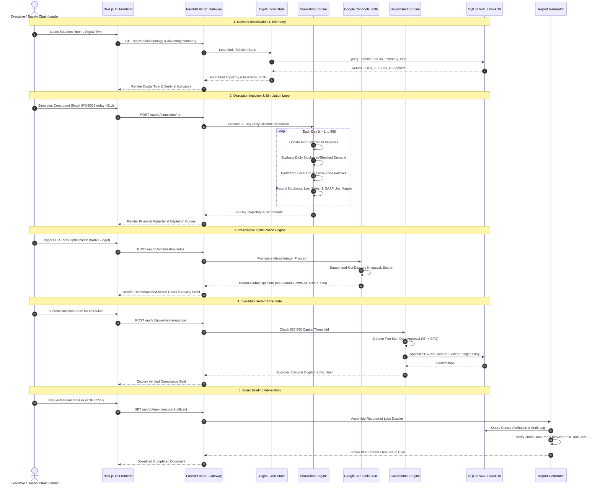

# SARAS ATLAS — Data Flow & Lifecycle Architecture

## 1. Overview
This document specifies the end-to-end data pipelines and lifecycle transitions within SARAS ATLAS, mapping the transmission of data from raw synthetic telemetry ingestion through deterministic simulation, mixed-integer optimization, governance auditing, and executive report generation.

---

## 2. End-to-End Data Flow Diagram



---

## 3. Data Flow Stages & Mathematical Transformations

### 3.1 Digital Twin State Hydration
- **Source**: SQLite tables `warehouses`, `suppliers`, `transportation_lanes`, `skus`, `inventory_records`, and `purchase_orders`.
- **Transformation**:
  - Raw table rows are loaded into immutable Pydantic models.
  - Multi-echelon graph is constructed with nodes (Warehouses, Suppliers) and directed edges (Lanes).
  - Safety stock thresholds are calculated:
    $$\text{Safety Stock} = Z_{\alpha} \times \sqrt{L \cdot \sigma_D^2 + D^2 \cdot \sigma_L^2}$$

### 3.2 Daily Discrete-Time Simulation Loop
- **Inputs**: Baseline topology, shock definitions ($PO_{delay} = 21\text{ days}$, Freight Surcharge $= +28\%$, Viral Demand $= +45\%$).
- **State Transition Equation**:
  $$I_{i,j}(t) = I_{i,j}(t-1) + \sum_{k} R_{k \to i, j}(t) - S_{i,j}(t)$$
  Where:
  - $I_{i,j}(t)$ is available inventory of SKU $j$ at facility $i$ on day $t$.
  - $R_{k \to i, j}(t)$ represents completed inbounds arriving on day $t$.
  - $S_{i,j}(t)$ represents fulfilled shipments on day $t$.
- **Stockout & Conservation**:
  If demand $D_{i,j}(t) > I_{i,j}(t-1)$, the deficit is routed to alternative warehouses via cross-zone fulfillment or recorded as lost demand:
  $$L_{i,j}(t) = \max(0, D_{i,j}(t) - I_{i,j}(t-1) - \text{Spillover}_{k \to i}(t))$$

### 3.3 Prescriptive Optimization Data Pipeline
- **Inputs**: Deficit demand ($1,968$ units), budget ceiling ($B = \$40,000.00$), air cost ($c_{air} = \$12.50$), ground cost ($c_{xfer} = \$3.20$), margin coefficients ($r_{air} = \$58.83, r_{xfer} = \$81.13$).
- **Solver**: SCIP (Solving Constraint Integer Programs).
- **Output**: Optimal allocation vector $(x_{air}^*, x_{xfer}^*, \theta_{ad}^*)$ serialized to JSON and delivered to the frontend.

### 3.4 Governance Audit Trail Pipeline
- **Trigger**: Any capital approval request.
- **Payload Schema**:
  ```json
  {
    "scenario_name": "ATLAS Optimal Mitigated Plan",
    "approver_role": "VP_OPERATIONS",
    "approver_name": "Marcus Vance",
    "approved_capital": 39997.50,
    "actions": {
      "air_freight_units": 2995,
      "transfer_units": 800,
      "ad_throttle_pct": 0.0
    }
  }
  ```
- **Cryptographic Hashing**:
  Each entry hashes the previous record's hash, timestamp, approver identities, and action payload using SHA-256:
  $$H_n = \text{SHA256}(H_{n-1} \,||\, T_n \,||\, \text{Approvers}_n \,||\, \text{Capital}_n \,||\, \text{Payload}_n)$$

---

## 4. Parity Assurance Between PDF and CSV Exports
Both report formats consume the single unified generator `ExecutiveReportGenerator.generate_report_data()`, guaranteeing:
1. Reconciled Financial Loss: $224,500.00 gross commercial exposure.
2. Net Margin Erosion: $129,844.32 GAAP net CM loss.
3. Identical KPI matrix (Baseline vs Unmitigated vs ATLAS Mitigated).
4. Reconciled Two-Man Rule signoff metadata.
