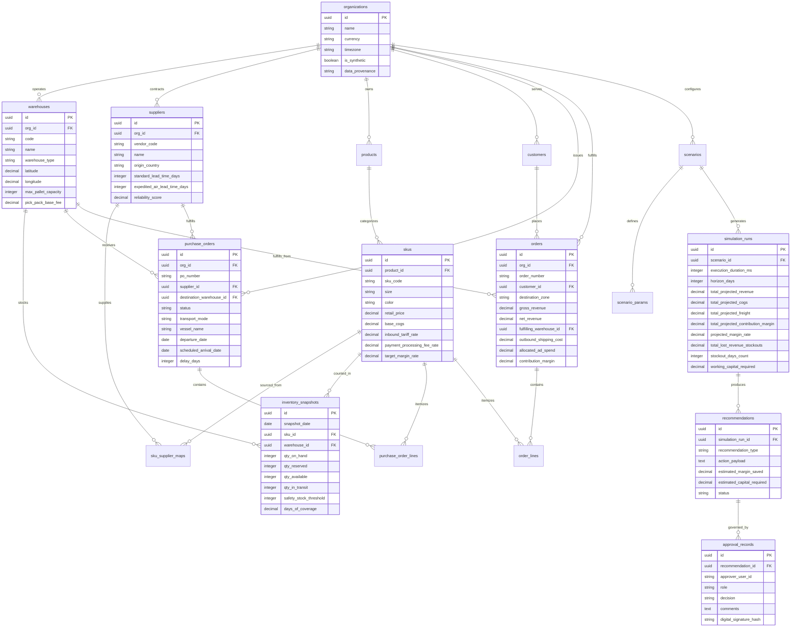

# SARAS ATLAS — Database Entity-Relationship (ER) Architecture

## 1. Overview
SARAS ATLAS utilizes an embedded relational storage architecture powered by **SQLite 3** operating in **Write-Ahead Logging (WAL)** mode. This design provides atomic, ACID-compliant transactions, foreign key integrity, and non-blocking concurrent reads with zero operational hosting overhead.

---

## 2. Entity-Relationship (ER) Diagram

---

## 3. Database Engine Configuration
- **Journal Mode**: `WAL` (Write-Ahead Logging) allows concurrent reads without locking writer transactions.
- **Synchronous Flag**: `NORMAL` maximizes write throughput while guaranteeing crash consistency.
- **Cache Size**: `-64000` (64 MB page cache) ensures high-velocity index lookups during 90-day simulation cycles.
- **Foreign Key Constraints**: `PRAGMA foreign_keys = ON;` strictly enforced across all 17 tables.
