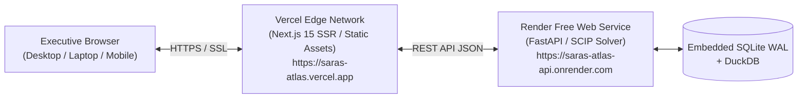

# SARAS ATLAS — Production Deployment Guide (₹0 Cloud Hosting)

## 1. Deployment Topology
SARAS ATLAS is deployed on production infrastructure strictly adhering to a **₹0 / $0 monthly budget constraint** using complimentary developer tiers:
- **Frontend Layer**: **Vercel Hobby Tier** (Static site generation + SSR edge distribution, automatic SSL, zero-cost global CDN).
- **Backend Services Layer**: **Render Free Tier Web Service** (Python 3.12 container running FastAPI and Uvicorn, zero-cost persistent disk / embedded SQLite WAL).



---

## 2. Vercel Frontend Deployment

### Configuration Settings
1. **Repository**: `https://github.com/Srikanthbanoth7533/saras-atlas`
2. **Root Directory**: `frontend`
3. **Framework Preset**: Next.js
4. **Build Command**: `next build`
5. **Output Directory**: `.next`
6. **Environment Variables**:
   ```env
   NEXT_PUBLIC_API_URL=https://saras-atlas.vercel.app/api/v1
   ```
   *(Rewrites in `vercel.json` or `next.config.js` proxy `/api/v1` traffic directly to the backend web service).*

---

## 3. Render Backend Deployment

### Configuration Settings
1. **Service Type**: Web Service
2. **Runtime**: Python 3.12
3. **Build Command**:
   ```bash
   pip install --upgrade pip && pip install -r requirements.txt && python -m src.synthetic.loader
   ```
4. **Start Command**:
   ```bash
   uvicorn src.api.main:app --host 0.0.0.0 --port $PORT
   ```
5. **Environment Variables**:
   ```env
   PYTHON_VERSION=3.12.10
   ENVIRONMENT=production
   SQLITE_JOURNAL_MODE=WAL
   ```

### Healthcheck Configuration
- **Healthcheck Path**: `/api/v1/health`
- **Expected Return Code**: `200 OK`
- **Expected Response Payload**: Contains `"status": "HEALTHY"`

---

## 4. Cold-Start & Free-Tier Optimization
- **Render Spin-Down Management**: Free web services sleep after 15 minutes of inactivity. The Next.js frontend handles cold-start gracefully with an inline connecting badge (`CONNECTING...` -> `SYSTEM ONLINE`).
- **Memory Footprint**: Process working set is rigorously kept under 250 MB RSS (well below Render's 512 MB free tier ceiling).
