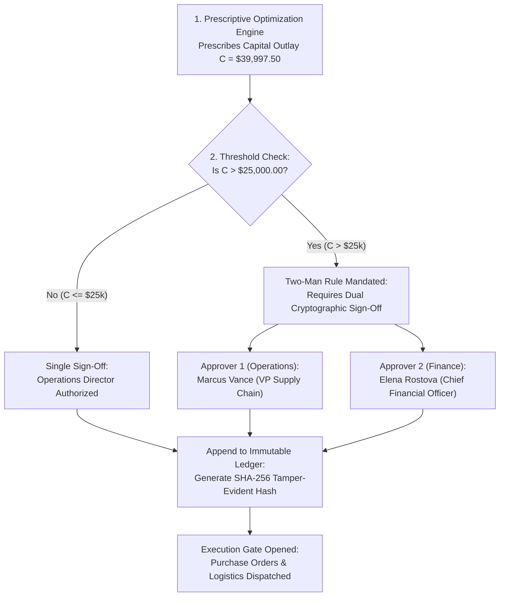

# SARAS ATLAS — Governance, RBAC & Cryptographic Audit Ledger

## 1. Overview
In enterprise commerce operations, automated AI recommendations that commit significant corporate treasury capital must be strictly governed. SARAS ATLAS implements a dual-key **Two-Man Rule** protocol, a granular **Role-Based Access Control (RBAC)** model, and an immutable **SHA-256 cryptographic audit ledger**.

---

## 2. The Two-Man Rule Protocol

---

## 3. Role-Based Access Control (RBAC) Matrix

| Endpoint Group | `VIEWER` | `OPERATOR` | `EXECUTIVE` | `ADMIN` |
| :--- | :---: | :---: | :---: | :---: |
| **Health & Telemetry** (`/health`, `/metrics`) | Read | Read | Read | Read / Reset |
| **Digital Twin & Risks** (`/twin/*`, `/risks/*`) | Read | Read | Read | Read / Write |
| **Simulation Studio** (`/simulation/*`) | Read | Execute | Execute | Execute |
| **Prescriptive Solver** (`/optimization/*`) | Read | Execute | Execute | Configure Weights |
| **Governance Approval (< $25k)** | — | Approve | Approve | Supervise |
| **Governance Approval (≥ $25k)** | — | Submit Only | Dual Sign-Off | Supervise |
| **Data Ingestion & Rollback** (`/ingestion/*`) | — | Stage Only | — | Commit / Rollback |
| **Cryptographic Audit Log** (`/governance/audit-trail`)| Read | Read | Read | Verify / Export |

---

## 4. Cryptographic SHA-256 Audit Trail Mechanics

Every governance action (submission, rejection, approval, or override) appends a new block to the immutable audit ledger.

### 4.1 Block Hash Calculation
The hash for record $n$ is computed deterministically:
$$H_n = \text{SHA-256}\Big( H_{n-1} \,\|\, T_n \,\|\, U_n \,\|\, R_n \,\|\, D_n \,\|\, C_n \,\|\, \text{Payload}_n \Big)$$

Where:
- $H_{n-1}$: SHA-256 hash of the immediately preceding audit record (genesis block uses fixed zero string).
- $T_n$: ISO 8601 UTC timestamp.
- $U_n$: Authenticated User ID (e.g., `user_marcus_vance`).
- $R_n$: Security role (`VP_SUPPLY_CHAIN`, `CHIEF_FINANCIAL_OFFICER`).
- $D_n$: Formal decision (`APPROVED`, `REJECTED`, `PENDING_SECOND_KEY`).
- $C_n$: Capital allocation amount ($39,997.50).
- $\text{Payload}_n$: Canonical JSON serialization of decision action vector.

### 4.2 Tamper Evident Verification
The platform verifies ledger integrity by recalculating hashes from the genesis record forward. Any manual database edit, altered timestamp, or swapped role breaks the hash chain, triggering an immediate security sentinel alert.
