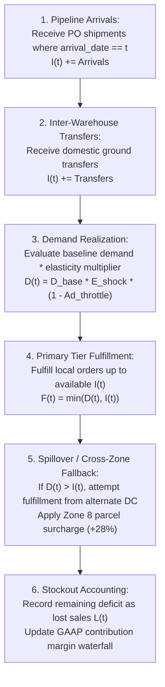

# SARAS ATLAS — Simulation Methodology & Discrete Mechanics

## 1. Overview
The SARAS ATLAS Simulation Studio models multi-echelon supply chain networks through a **deterministic discrete-time daily event simulation**. It captures the interactions between stochastic/shocked customer demand, upstream supplier manufacturing delays, transportation bottlenecks, and inventory replenishment policies across multiple facilities.

---

## 2. Mathematical State Representation

Let the network state on day $t \in \{1, \dots, H\}$ (where $H = 90$ days) be defined by:
- $I_{w,s}(t)$: Usable on-hand inventory of SKU $s$ at warehouse $w$.
- $P_{w,s}(t)$: Pipeline transit inventory destined for warehouse $w$ arriving on day $t$.
- $D_{w,s}(t)$: Customer order demand arriving at warehouse $w$ on day $t$.
- $F_{w,s}(t)$: Fulfilled orders directly from warehouse $w$ on day $t$.
- $C_{w \to v, s}(t)$: Cross-zone fulfilled orders from alternate warehouse $v$ to serve warehouse $w$'s territory.
- $L_{w,s}(t)$: Unfulfilled orders (lost sales) at warehouse $w$ on day $t$.

---

## 3. Daily Event Execution Order

Within each simulated day $t$, events execute in strict chronological sequence:

---

## 4. Shock Propagation Mechanics

### 4.1 Upstream Supplier Delays
When an inbound purchase order (e.g. `PO-9012`) encounters a port congestion delay $\Delta L_{po}$ (e.g., $+21$ days), the scheduled arrival date is shifted:
$$t_{\text{arrival}} = t_{\text{scheduled}} + \Delta L_{po}$$
During the window $t_{\text{scheduled}} \le t < t_{\text{arrival}}$, no replenishment arrives at the destination warehouse.

### 4.2 Cross-Zone Outbound Routing & Surcharges
When local inventory at WH-WEST (Reno/Los Angeles) depletes, pending orders spill over to WH-EAST (Allentown):
- Outbound shipping fee increases from local Zone 2 rate ($8.50) to cross-country Zone 8 rate ($16.80).
- Spot surcharge ($+28\%$) elevates shipping cost to $21.50 per unit.
- This creates severe margin compression: unit contribution margin falls from $71.33 (39.63%) to $58.33 (32.40%).

### 4.3 Demand Elasticity & Viral Surge
Demand elasticity shocks scale baseline order volume:
$$D(t) = D_{\text{base}}(t) \times \mu_{\text{elasticity}} \times (1 - \theta_{\text{ad}})$$
Where:
- $\mu_{\text{elasticity}} = 1.45$ represents a 45% demand surge for Apex Shell Jacket.
- $\theta_{\text{ad}}$ represents marketing throttle reduction percentage.

---

## 5. Deterministic Guarantee
The simulation loop avoids floating-point nondeterminism by using discrete integer unit accounting and fixed penny-rounding for monetary values. Successive runs with identical input parameters yield 100% bit-for-bit identical outputs.
