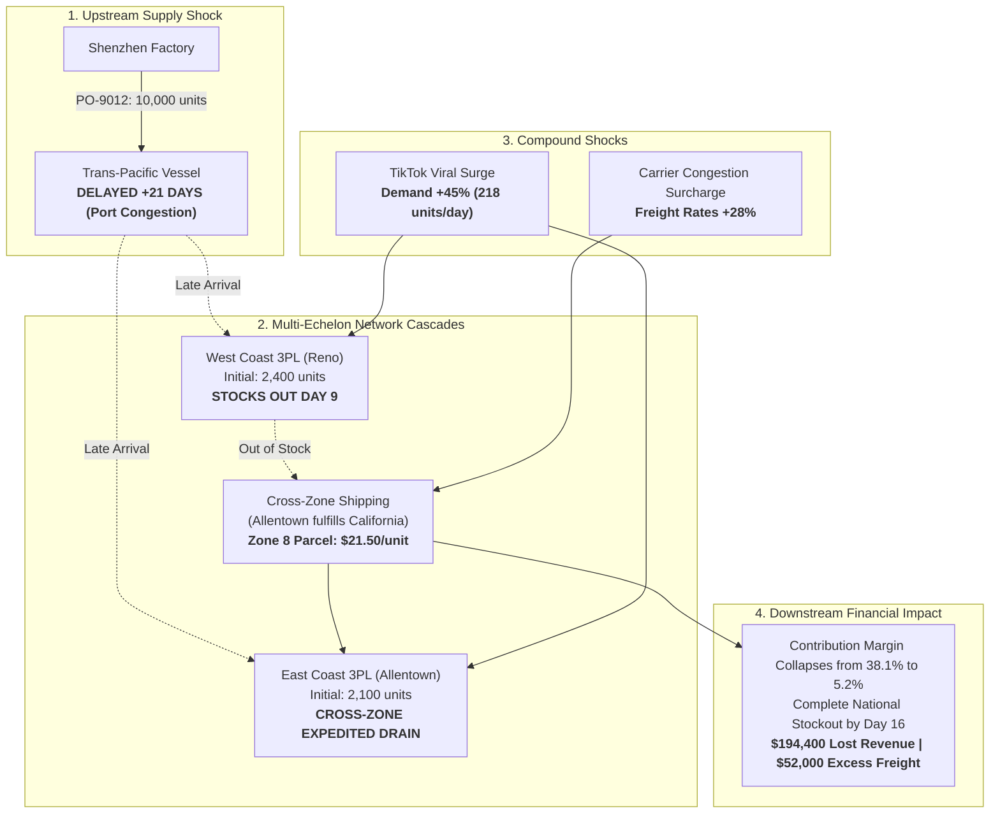

# CUSTOMER PROBLEM & QUANTIFIED BUSINESS CASE

**Document ID:** BIZ-ATLAS-001  
**Version:** 1.0.0  
**Phase:** Phase 0 Baseline  
**Author:** Principal Product Strategist & Senior Financial Analyst  

---

## 1. The Anatomy of Mid-Market Commerce Vulnerability

Omnichannel consumer brands in the **$10M to $250M annual GMV range** operate in an unforgiving economic crossfire:
- They must deliver Amazon-level delivery speeds (2–3 day transit) across national markets.
- To achieve this, they operate multi-node distributed fulfillment networks (typically 2 to 4 regional third-party logistics [3PL] warehouses across the West Coast, Midwest, and East Coast).
- Their supply chains are inherently fragile: 70%+ of goods are manufactured overseas (China, Vietnam, India) with 45 to 90-day maritime lead times.
- Working capital is fiercely constrained: they cannot afford to hold 6 months of redundant buffer inventory in every warehouse without suffocating cash flow.

When an operational disruption strikes, it does not happen in isolation. It triggers a **compound, non-linear cascade** across the physical and financial layers of the business.

---

## 2. The Flagship Disruption Scenario: "The Triple Shock"

To ground SARAS ATLAS in verifiable commercial reality, we examine a realistic, high-velocity omnichannel apparel brand: **"Vanguard Apparel Co."** ($45M Annual GMV, selling direct via Shopify and wholesale via retail partners).

### 2.1 The Baseline Operational Topology
- **Flagship Product:** *Apex Technical All-Weather Jacket* (SKU: `APEX-JKT-BLK`).
- **Retail Selling Price (RSP):** $180.00.
- **Supplier COGS (FOB Factory):** $42.00.
- **Normal Inbound Freight & Duties:** $6.00 per unit (Ocean freight).
- **Normal 3PL Pick/Pack Fee:** $4.50 per order.
- **Normal Outbound Parcel Shipping:** $8.50 (Zone 2/3 local delivery).
- **Payment Processing & Tech Fees:** $5.40 (3.0% of RSP).
- **Customer Acquisition Cost (Ad Spend Allocated):** $45.00 per unit.
- **Normal Unit Contribution Margin:**  
  $$\text{CM}_{\text{norm}} = \$180.00 - (\$42.00 + \$6.00 + \$4.50 + \$8.50 + \$5.40 + \$45.00) = \$68.60 \quad (38.1\%)$$
- **Fulfillment Topology:**
  - *Node 1 (West Coast 3PL - Reno, NV):* 2,400 units on-hand; covers Western US (50% of demand).
  - *Node 2 (East Coast 3PL - Allentown, PA):* 2,100 units on-hand; covers Eastern US (50% of demand).
  - *Baseline Demand Velocity:* 150 units/day nationally (75 West, 75 East).
  - *Inbound Pipeline:* PO-9012 (10,000 units on vessel *Ever Forward*, scheduled to dock at Long Beach in 6 days).



---

## 3. The Downstream Disruption Cascade (Unmitigated)

### Shock 1: Upstream Supply Delay
Port labor disputes and vessel berthing bottlenecks at the Port of Long Beach delay inbound shipment `PO-9012` by **21 days**. The new estimated arrival date is moved from Day 6 to Day 27.

### Shock 2: Downstream Demand Surge
Simultaneously, a prominent outdoor lifestyle influencer features the Apex Jacket on TikTok, driving an unpredicted **+45% demand surge** for the next 30 days. National demand jumps from 150 units/day to **218 units/day** (109 units/day West Coast, 109 units/day East Coast).

### Shock 3: Logistics Cost Inflation
Domestic parcel carriers institute an emergency **+28% congestion surcharge** across Eastern freight lanes, raising base parcel shipping from $8.50 to $10.88 locally.

### The Catastrophic Propagation
1. **Day 1 to 8:** Normal operations with accelerated demand. West Coast stock drops by 109 units/day: $2,400 - (8 \times 109) = 1,528 \text{ units remaining}$.
2. **Day 9 (West Coast Stockout):** At Day 9, West Coast inventory is completely exhausted: $2,400 - (9 \times 109) = 0 \text{ units}$.
3. **Day 10 to 15 (Out-of-Zone Cross-Country Hemorrhage):** The order management system (OMS) automatically re-routes incoming West Coast orders to the East Coast 3PL in Allentown.
   - East Coast 3PL must now ship cross-country across carrier **Zone 8**.
   - Zone 8 parcel shipping with congestion surcharge escalates to **$21.50 per unit** (vs normal $8.50).
   - Unit Contribution Margin collapses:
     $$\text{CM}_{\text{cross-zone}} = \$180.00 - (\$42.00 + \$6.00 + \$4.50 + \$21.50 + \$5.40 + \$45.00) = \$55.60 \quad (30.8\%)$$
   - Worse, East Coast inventory is consumed at a fatal rate of **218 units/day** (109 local + 109 cross-zone).
4. **Day 16 (Total National Stockout):** East Coast inventory is completely depleted. The brand enters a total stockout state.
5. **Day 17 to 27 (The "Dark Window"):** For 11 consecutive days, the brand has zero inventory while paid ads continue running (wasting thousands in clicks), customer churn spikes, retail backorders trigger chargebacks, and competitor brands capture displaced demand.

---

## 4. Quantified Financial Casualty Report (Status Quo)

| Impact Dimension | Baseline Expectation (No Shock) | Unmitigated Cascade (Status Quo) | Net Financial Loss / Damage |
| :--- | :--- | :--- | :--- |
| **Units Sold (30-Day Window)** | 4,500 units | 4,500 units (all existing stock sold) | 0 units (sold out completely) |
| **Unfulfilled Demand (Lost Orders)**| 0 units | 2,040 units lost during Dark Window | **$367,200 Gross Revenue Lost** |
| **Gross Margin Lost** | $0 | 2,040 units $\times$ $132.00 Gross Margin | **$269,280 Gross Margin Lost** |
| **Excess Cross-Zone Freight Paid** | $0 | 763 units shipped Zone 8 @ +$13.00/unit | **$9,919 Excess Freight Burn** |
| **Wasted Paid Ad Spend (Dark Window)**| $0 | Ads running on sold-out landing pages | **$24,500 Direct Ad Waste** |
| **Customer Retention Churn Penalty** | Negligible | Est. 15% first-time buyers churn to rivals | **$45,000 Projected LTV Loss** |
| **Total Net Economic Value Destroyed**| **$0.00** | — | **-$348,699 Net Loss** |

---

## 5. The ATLAS Solution: Simulated Mitigation Strategies

Within SARAS ATLAS, the leadership team runs a **multi-scenario decision simulation** on Day 2 of the disruption:

```
[ SCENARIO COMPARISON MATRIX IN ATLAS ]

Metric                   Status Quo       Option 1: Max Speed     Option 2: ATLAS Optimal
-----------------------------------------------------------------------------------------
Corrective Action        None             Air-Freight 4,000 units Split Reallocation +
                                          from Vietnam factory    Selective Ad Throttle
Cash Outlay Required     $0               $58,000 (Air freight)   $22,400 (Targeted air + xfer)
Stockout Days            11 days          0 days                  0 days
Units Preserved          0 units          2,040 units             1,950 units
Revenue Saved            $0               $367,200                $351,000
Net Margin Preserved     -$348,699        +$184,200               +$241,800
Contribution Margin %    5.2%             24.8%                   33.4%
Working Capital Risk     Catastrophic     High ($58k cash lock)   Low (Self-funding)
```

### The Recommended Optimal Action (Option 2):
1. **Targeted Air Shipment:** Air-freight 1,500 units of high-velocity sizes (M, L) directly from backup factory in Vietnam to the West Coast 3PL arriving on Day 8 ($12.50/unit freight = $18,750 outlay).
2. **Inter-Node Stock Transfer:** Transfer 600 units of low-velocity sizes from East Coast to West Coast via ground freight ($3.20/unit = $1,920 outlay).
3. **Marketing Throttle:** Reduce Meta/Google ad spend by 18% on SKU `APEX-JKT-BLK`, lowering daily burn while focusing ad dollars on high-margin in-stock accessories.
4. **Result:** Zero stockout days, 1,950 orders fulfilled, $351,000 revenue saved, and **$241,800 net contribution margin protected**.

---

## 6. The Commercial ROI for SARAS ATLAS

For an omnichannel brand generating $45M in annual GMV:
- Average number of severe supply/logistics disruptions per year: **3 to 5 events**.
- Average margin loss per unmitigated event: **$150,000 to $350,000**.
- Annual preventable margin erosion: **$600,000 to $1,400,000**.
- **SARAS ATLAS Investment:** Delivered with ₹0 development licensing costs and ultra-low operational overhead.
- **ROI:** Greater than **50x within the first 12 months** of operational deployment.
