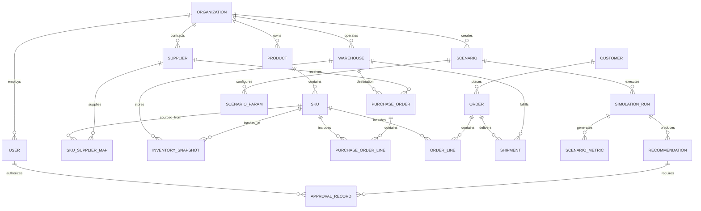

# CANONICAL COMMERCE DATABASE & DATA MODEL SPECIFICATION

**Document ID:** DATA-ATLAS-001  
**Version:** 1.0.0  
**Phase:** Phase 0 Baseline  
**Author:** Senior Data Engineer & Enterprise Database Architect  

---

## 1. Data Modeling Objectives & Design Principles

The SARAS ATLAS canonical commerce data model is designed to represent both the **physical supply chain graph** and the **financial unit economics** of an omnichannel e-commerce brand.

Core design principles:
1. **Relational Rigor & Integrity:** Fully normalized (3NF) core entities with foreign key constraints, composite unique indexes, and audit timestamps.
2. **Dual-Dialect Compatibility:** Defined using **SQLAlchemy 2.0 Declarative Models**, running natively on in-process SQLite 3 (WAL mode) and seamlessly portable to PostgreSQL without schema modifications.
3. **Temporal Multi-Echelon Tracking:** Supports daily inventory balance snapshots, tracking goods across four explicit operational states: On-Hand, Reserved, In-Transit, and Backordered.
4. **Sandboxed Scenario Branching:** Ephemeral and persisted simulation scenarios inherit baseline states without mutating underlying operational records.

---

## 2. Entity-Relationship (ER) Diagram



---

## 3. Canonical Schema Definitions

### 3.1 Core Enterprise & Master Data Entities

#### `organizations`
Represents the tenant or merchant operating the business.
```sql
CREATE TABLE organizations (
    id VARCHAR(36) PRIMARY KEY,
    name VARCHAR(255) NOT NULL,
    currency VARCHAR(3) DEFAULT 'USD',
    timezone VARCHAR(64) DEFAULT 'America/Los_Angeles',
    created_at TIMESTAMP WITH TIME ZONE DEFAULT CURRENT_TIMESTAMP,
    updated_at TIMESTAMP WITH TIME ZONE DEFAULT CURRENT_TIMESTAMP
);
```

#### `warehouses`
Physical logistics nodes (distribution centers, 3PL facilities, or retail stores).
```sql
CREATE TABLE warehouses (
    id VARCHAR(36) PRIMARY KEY,
    org_id VARCHAR(36) NOT NULL REFERENCES organizations(id) ON DELETE CASCADE,
    code VARCHAR(32) NOT NULL UNIQUE,          -- e.g. 'WH-WEST-RENO'
    name VARCHAR(255) NOT NULL,
    warehouse_type VARCHAR(32) NOT NULL,       -- '3PL', 'CENTRAL_HUB', 'RETAIL_STORE'
    street_address VARCHAR(255),
    city VARCHAR(100) NOT NULL,
    state VARCHAR(32) NOT NULL,
    postal_code VARCHAR(32) NOT NULL,
    country VARCHAR(3) DEFAULT 'USA',
    latitude DECIMAL(10, 6),
    longitude DECIMAL(10, 6),
    max_pallet_capacity INTEGER,
    daily_holding_cost_per_unit DECIMAL(10, 4) DEFAULT 0.0150,
    pick_pack_base_fee DECIMAL(10, 2) DEFAULT 4.50,
    created_at TIMESTAMP WITH TIME ZONE DEFAULT CURRENT_TIMESTAMP
);
CREATE INDEX idx_warehouses_org ON warehouses(org_id);
```

#### `suppliers`
Manufacturing facilities, vendors, or primary suppliers.
```sql
CREATE TABLE suppliers (
    id VARCHAR(36) PRIMARY KEY,
    org_id VARCHAR(36) NOT NULL REFERENCES organizations(id) ON DELETE CASCADE,
    name VARCHAR(255) NOT NULL,
    vendor_code VARCHAR(32) NOT NULL UNIQUE,   -- e.g. 'VEND-SHENZHEN-01'
    origin_country VARCHAR(3) NOT NULL,        -- 'CHN', 'VNM', 'IND', 'USA'
    origin_port VARCHAR(64),                   -- e.g. 'Yantian'
    standard_lead_time_days INTEGER NOT NULL,  -- e.g. 45
    expedited_air_lead_time_days INTEGER,      -- e.g. 8
    reliability_score DECIMAL(5, 4) DEFAULT 0.9200, -- Historical on-time delivery rate
    payment_terms VARCHAR(64) DEFAULT 'Net 60',
    created_at TIMESTAMP WITH TIME ZONE DEFAULT CURRENT_TIMESTAMP
);
CREATE INDEX idx_suppliers_org ON suppliers(org_id);
```

#### `products` & `skus`
Product hierarchy and unit-level stock keeping units.
```sql
CREATE TABLE products (
    id VARCHAR(36) PRIMARY KEY,
    org_id VARCHAR(36) NOT NULL REFERENCES organizations(id) ON DELETE CASCADE,
    title VARCHAR(255) NOT NULL,
    category VARCHAR(100) NOT NULL,            -- e.g. 'Apparel', 'Footwear'
    created_at TIMESTAMP WITH TIME ZONE DEFAULT CURRENT_TIMESTAMP
);

CREATE TABLE skus (
    id VARCHAR(36) PRIMARY KEY,
    product_id VARCHAR(36) NOT NULL REFERENCES products(id) ON DELETE CASCADE,
    sku_code VARCHAR(64) NOT NULL UNIQUE,      -- e.g. 'APEX-JKT-BLK-M'
    barcode VARCHAR(64),
    size VARCHAR(32),
    color VARCHAR(64),
    weight_kg DECIMAL(8, 3) NOT NULL DEFAULT 0.500,
    retail_price DECIMAL(10, 2) NOT NULL,      -- $180.00
    base_cogs DECIMAL(10, 2) NOT NULL,         -- $42.00
    inbound_tariff_rate DECIMAL(5, 4) DEFAULT 0.0750, -- 7.5% customs duty
    payment_processing_fee_rate DECIMAL(5, 4) DEFAULT 0.0290, -- 2.9% Stripe/Shopify fee
    target_margin_rate DECIMAL(5, 4) DEFAULT 0.3500,  -- 35% target contribution margin
    status VARCHAR(32) DEFAULT 'ACTIVE',
    created_at TIMESTAMP WITH TIME ZONE DEFAULT CURRENT_TIMESTAMP
);
CREATE INDEX idx_skus_product ON skus(product_id);
CREATE INDEX idx_skus_code ON skus(sku_code);
```

#### `sku_supplier_maps`
Many-to-many relationship linking SKUs with primary and backup suppliers.
```sql
CREATE TABLE sku_supplier_maps (
    id VARCHAR(36) PRIMARY KEY,
    sku_id VARCHAR(36) NOT NULL REFERENCES skus(id) ON DELETE CASCADE,
    supplier_id VARCHAR(36) NOT NULL REFERENCES suppliers(id) ON DELETE CASCADE,
    is_primary BOOLEAN DEFAULT TRUE,
    supplier_unit_cost DECIMAL(10, 2) NOT NULL,  -- Contracted FOB price
    minimum_order_qty INTEGER NOT NULL DEFAULT 500,
    inbound_freight_cost_ocean DECIMAL(10, 2) DEFAULT 6.00,
    inbound_freight_cost_air DECIMAL(10, 2) DEFAULT 14.50,
    lead_time_days INTEGER NOT NULL,
    created_at TIMESTAMP WITH TIME ZONE DEFAULT CURRENT_TIMESTAMP,
    CONSTRAINT uq_sku_supplier UNIQUE (sku_id, supplier_id)
);
```

---

### 3.2 Inventory & Supply Chain State Entities

#### `inventory_snapshots`
Daily multi-echelon stock levels across each warehouse node.
```sql
CREATE TABLE inventory_snapshots (
    id VARCHAR(36) PRIMARY KEY,
    snapshot_date DATE NOT NULL,
    sku_id VARCHAR(36) NOT NULL REFERENCES skus(id) ON DELETE CASCADE,
    warehouse_id VARCHAR(36) NOT NULL REFERENCES warehouses(id) ON DELETE CASCADE,
    qty_on_hand INTEGER NOT NULL DEFAULT 0,         -- Physical inventory in warehouse
    qty_reserved INTEGER NOT NULL DEFAULT 0,        -- Committed to open unfulfilled orders
    qty_available INTEGER GENERATED ALWAYS AS (qty_on_hand - qty_reserved) STORED,
    qty_in_transit INTEGER NOT NULL DEFAULT 0,      -- Inbound POs on the water/air
    qty_backordered INTEGER NOT NULL DEFAULT 0,     -- Unmet customer demand
    safety_stock_threshold INTEGER DEFAULT 150,
    days_of_coverage DECIMAL(8, 2),                -- Computed DoC based on 30d run rate
    created_at TIMESTAMP WITH TIME ZONE DEFAULT CURRENT_TIMESTAMP,
    CONSTRAINT uq_inv_snap UNIQUE (snapshot_date, sku_id, warehouse_id)
);
CREATE INDEX idx_inv_snap_lookup ON inventory_snapshots(snapshot_date, sku_id, warehouse_id);
```

#### `purchase_orders` & `purchase_order_lines`
Inbound supply pipelines tracking shipments across transit stages.
```sql
CREATE TABLE purchase_orders (
    id VARCHAR(36) PRIMARY KEY,
    org_id VARCHAR(36) NOT NULL REFERENCES organizations(id) ON DELETE CASCADE,
    po_number VARCHAR(64) NOT NULL UNIQUE,       -- e.g. 'PO-9012'
    supplier_id VARCHAR(36) NOT NULL REFERENCES suppliers(id),
    destination_warehouse_id VARCHAR(36) NOT NULL REFERENCES warehouses(id),
    status VARCHAR(32) NOT NULL,                 -- 'PLANNED', 'IN_TRANSIT', 'PORT_CONGESTION', 'RECEIVED'
    transport_mode VARCHAR(32) NOT NULL,         -- 'OCEAN', 'AIR', 'TRUCK'
    tracking_number VARCHAR(128),
    vessel_name VARCHAR(128),                    -- e.g. 'Ever Forward'
    port_of_entry VARCHAR(64),                   -- e.g. 'Long Beach'
    departure_date DATE,
    scheduled_arrival_date DATE NOT NULL,
    revised_arrival_date DATE NOT NULL,
    actual_arrival_date DATE,
    delay_days INTEGER GENERATED ALWAYS AS (CAST((julianday(revised_arrival_date) - julianday(scheduled_arrival_date)) AS INTEGER)) STORED,
    inbound_freight_total DECIMAL(12, 2) NOT NULL,
    created_at TIMESTAMP WITH TIME ZONE DEFAULT CURRENT_TIMESTAMP
);

CREATE TABLE purchase_order_lines (
    id VARCHAR(36) PRIMARY KEY,
    purchase_order_id VARCHAR(36) NOT NULL REFERENCES purchase_orders(id) ON DELETE CASCADE,
    sku_id VARCHAR(36) NOT NULL REFERENCES skus(id),
    qty_ordered INTEGER NOT NULL,
    qty_received INTEGER DEFAULT 0,
    unit_price DECIMAL(10, 2) NOT NULL,
    line_total DECIMAL(12, 2) NOT NULL
);
CREATE INDEX idx_po_status ON purchase_orders(status);
```

---

### 3.3 Demand & Customer Order Entities

#### `orders` & `order_lines`
Historical and projected customer transactions.
```sql
CREATE TABLE orders (
    id VARCHAR(36) PRIMARY KEY,
    org_id VARCHAR(36) NOT NULL REFERENCES organizations(id) ON DELETE CASCADE,
    order_number VARCHAR(64) NOT NULL UNIQUE,    -- e.g. 'ORD-10821'
    order_date TIMESTAMP WITH TIME ZONE NOT NULL,
    customer_id VARCHAR(36),
    destination_state VARCHAR(32) NOT NULL,      -- Used for Carrier Zone calculation
    destination_postal_code VARCHAR(32) NOT NULL,
    destination_zone INTEGER NOT NULL,           -- USPS / FedEx Zone 1 through 8
    order_channel VARCHAR(32) DEFAULT 'SHOPIFY', -- 'SHOPIFY', 'AMAZON', 'WHOLESALE'
    gross_revenue DECIMAL(10, 2) NOT NULL,
    discounts_total DECIMAL(10, 2) DEFAULT 0.00,
    net_revenue DECIMAL(10, 2) NOT NULL,
    status VARCHAR(32) NOT NULL,                 -- 'FULFILLED', 'SPLIT_FULFILLED', 'BACKORDERED'
    fulfilling_warehouse_id VARCHAR(36) REFERENCES warehouses(id),
    outbound_shipping_cost DECIMAL(10, 2) NOT NULL,
    allocated_ad_spend DECIMAL(10, 2) DEFAULT 0.00,
    contribution_margin DECIMAL(10, 2) NOT NULL,
    created_at TIMESTAMP WITH TIME ZONE DEFAULT CURRENT_TIMESTAMP
);

CREATE TABLE order_lines (
    id VARCHAR(36) PRIMARY KEY,
    order_id VARCHAR(36) NOT NULL REFERENCES orders(id) ON DELETE CASCADE,
    sku_id VARCHAR(36) NOT NULL REFERENCES skus(id),
    qty INTEGER NOT NULL,
    unit_price DECIMAL(10, 2) NOT NULL,
    unit_cogs DECIMAL(10, 2) NOT NULL,
    line_revenue DECIMAL(10, 2) NOT NULL
);
CREATE INDEX idx_orders_date ON orders(order_date);
CREATE INDEX idx_orders_wh ON orders(fulfilling_warehouse_id);
```

---

### 3.4 Scenario Simulation & Decision Governance Entities

#### `scenarios` & `scenario_params`
Stores baseline clones and counterfactual parameter shocks.
```sql
CREATE TABLE scenarios (
    id VARCHAR(36) PRIMARY KEY,
    org_id VARCHAR(36) NOT NULL REFERENCES organizations(id) ON DELETE CASCADE,
    name VARCHAR(255) NOT NULL,                  -- e.g. 'Disruption: Trans-Pacific Delay + Freight Surcharge'
    description TEXT,
    scenario_type VARCHAR(32) NOT NULL,          -- 'BASELINE', 'DISRUPTION', 'MITIGATION_OPTIMAL'
    is_active BOOLEAN DEFAULT TRUE,
    created_by_user_id VARCHAR(36),
    created_at TIMESTAMP WITH TIME ZONE DEFAULT CURRENT_TIMESTAMP
);

CREATE TABLE scenario_params (
    id VARCHAR(36) PRIMARY KEY,
    scenario_id VARCHAR(36) NOT NULL REFERENCES scenarios(id) ON DELETE CASCADE,
    param_key VARCHAR(64) NOT NULL,              -- e.g. 'SUPPLIER_DELAY_DAYS', 'FREIGHT_SURCHARGE_PCT'
    param_value DECIMAL(12, 4) NOT NULL,        -- e.g. 21.0000, 0.2800
    target_entity_type VARCHAR(32),              -- 'PURCHASE_ORDER', 'CARRIER_LANE', 'SKU'
    target_entity_id VARCHAR(64),                -- 'PO-9012'
    created_at TIMESTAMP WITH TIME ZONE DEFAULT CURRENT_TIMESTAMP,
    CONSTRAINT uq_scenario_param UNIQUE (scenario_id, param_key, target_entity_id)
);
```

#### `simulation_runs` & `scenario_metrics`
Persisted output of simulation runs for side-by-side comparison.
```sql
CREATE TABLE simulation_runs (
    id VARCHAR(36) PRIMARY KEY,
    scenario_id VARCHAR(36) NOT NULL REFERENCES scenarios(id) ON DELETE CASCADE,
    executed_at TIMESTAMP WITH TIME ZONE DEFAULT CURRENT_TIMESTAMP,
    execution_duration_ms INTEGER NOT NULL,
    horizon_days INTEGER DEFAULT 90,
    total_projected_revenue DECIMAL(14, 2) NOT NULL,
    total_projected_cogs DECIMAL(14, 2) NOT NULL,
    total_projected_freight DECIMAL(14, 2) NOT NULL,
    total_projected_contribution_margin DECIMAL(14, 2) NOT NULL,
    projected_margin_rate DECIMAL(6, 4) NOT NULL,
    total_lost_revenue_stockouts DECIMAL(14, 2) NOT NULL,
    stockout_days_count INTEGER NOT NULL,
    working_capital_required DECIMAL(14, 2) NOT NULL
);
```

#### `recommendations` & `approval_records`
Prescriptive optimization actions requiring governance sign-off.
```sql
CREATE TABLE recommendations (
    id VARCHAR(36) PRIMARY KEY,
    simulation_run_id VARCHAR(36) NOT NULL REFERENCES simulation_runs(id) ON DELETE CASCADE,
    recommendation_type VARCHAR(64) NOT NULL,    -- 'AIR_FREIGHT_SPLIT', 'INTER_NODE_TRANSFER', 'AD_THROTTLE'
    action_payload JSON NOT NULL,                -- Structured instructions (units, origins, costs)
    estimated_margin_saved DECIMAL(12, 2) NOT NULL,
    estimated_capital_required DECIMAL(12, 2) NOT NULL,
    status VARCHAR(32) DEFAULT 'PENDING_APPROVAL', -- 'PENDING_APPROVAL', 'APPROVED', 'REJECTED'
    created_at TIMESTAMP WITH TIME ZONE DEFAULT CURRENT_TIMESTAMP
);

CREATE TABLE approval_records (
    id VARCHAR(36) PRIMARY KEY,
    recommendation_id VARCHAR(36) NOT NULL REFERENCES recommendations(id) ON DELETE CASCADE,
    approver_user_id VARCHAR(36) NOT NULL,
    role VARCHAR(32) NOT NULL,                   -- 'COO', 'CFO', 'FOUNDER'
    action VARCHAR(32) NOT NULL,                 -- 'APPROVED', 'REJECTED'
    comments TEXT,
    approved_at TIMESTAMP WITH TIME ZONE DEFAULT CURRENT_TIMESTAMP,
    digital_signature_hash VARCHAR(128) NOT NULL -- Cryptographic audit fingerprint
);
```

---

## 4. Synthetic Dataset Strategy & Labeling Standards

To validate the flagship scenario rigorously without accessing confidential customer data, SARAS ATLAS incorporates a dedicated synthetic dataset generator:
- **Brand Identity:** `Vanguard Apparel Co.` (Synthetic D2C & Omnichannel Brand).
- **Scale:** 50 SKUs across 2 product families (Technical Outerwear, Activewear), 3 3PL fulfillment centers (West Coast, East Coast, Central), 2 overseas suppliers (Shenzhen, Vietnam), 180 days of historical transactions (~25,000 orders), and 6 active purchase orders.
- **Strict Labeling Standard:** Every synthetic record generated is tagged with:
  `synthetic_flag = TRUE` and `dataset_provenance = 'SARAS_ATLAS_SYNTHETIC_BENCHMARK_V1'`.
- All mock data is deterministically seeded (`seed = 42`) for 100% reproducible test verification.
