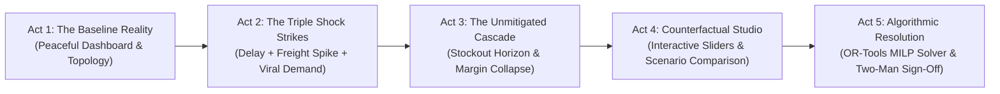

# EXECUTIVE DEMONSTRATION STRATEGY & NARRATIVE WALKTHROUGH

**Document ID:** DEMO-ATLAS-001  
**Version:** 1.0.0  
**Phase:** Phase 0 Baseline  
**Author:** Principal Product Strategist & Autonomous CTO  
**Target Audience:** Saras Analytics Founders, CEOs, CTOs, Enterprise Clients (e.g. Faherty, AG1), and Technical Leaders  

---

## 1. Executive Demonstration Philosophy

An executive presentation to founders, CTOs, and seasoned operators must avoid hand-waving conceptual slides. It must deliver an **undeniable, mathematically verified, interactive demonstration of value** within 12 minutes.

The demonstration is structured as a **High-Stakes 5-Act Operational Drama**:
- **Duration:** 10 to 12 minutes.
- **Narrative Arc:** From calm stability $\rightarrow$ sudden multi-variable crisis $\rightarrow$ cascading panic $\rightarrow$ algorithmic clarity $\rightarrow$ decisive, high-margin resolution.

---

## 2. The 5-Act Live Demonstration Script

### Act 1: The Baseline Reality (2 Minutes)
- **Visual:** Executive Situation Room dashboard showing `Vanguard Apparel Co.` ($45M GMV).
- **Presenter Script:**  
  *"Good morning. You are looking at SARAS ATLAS, connected to the digital twin of Vanguard Apparel Co. Today is Day 1. The business is running smoothly: 45 days of inventory across three regional distribution centers, healthy 38.1% Contribution Margin, and 10,000 units of our flagship Apex All-Weather Jacket aboard the vessel Ever Forward, docking in Long Beach in 6 days. Our marketing campaigns are acquiring customers at a healthy $45 CAC."*
- **Key Talking Point:** Point to the interactive Network Topology Map showing the smooth flow of goods from Shenzhen to Reno and Allentown.

---

### Act 2: The Triple Shock Strikes (2 Minutes)
- **Visual:** An alert flashes amber, then crimson on the Situation Room Sentinel ticker:
  `CRITICAL SHOCK DETECTED: PO-9012 DELAYED +21 DAYS | EAST COAST PARCEL SURCHARGE +28% | TIKTOK DEMAND +45%`
- **Presenter Script:**  
  *"At 8:15 AM, three simultaneous disruptions strike: First, port labor congestion in Long Beach pushes our 10,000-unit shipment back by 21 days. Second, domestic carriers impose a surprise 28% peak congestion surcharge on our East Coast fulfillment lanes. Third, an outdoor lifestyle creator's TikTok video goes viral, driving demand for the Apex Jacket up by 45%. Traditional BI dashboards tell us sales are spiking, but they cannot tell us what is about to happen to our inventory and cash."*

---

### Act 3: The Unmitigated Cascade (2.5 Minutes)
- **Visual:** ATLAS automatically projects the forward-looking 90-day trajectory under the Status Quo.
- **Presenter Script:**  
  *"Watch what ATLAS computes across the multi-echelon network in under 100 milliseconds:  
  1. Our West Coast warehouse runs completely dry on Day 9.  
  2. The automated order management system re-routes California orders to our Allentown, PA warehouse.  
  3. That triggers punitive Zone 8 cross-country parcel rates—raising shipping from $8.50 to $21.50 per unit.  
  4. Our Contribution Margin collapses from 38.1% to 5.2%.  
  5. Worse, on Day 16, Allentown stocks out completely. The brand enters an 11-day 'Dark Window' of zero inventory while paid ads continue burning cash.  
  Total economic destruction: $367,200 in gross revenue lost, $269,280 in gross margin vaporized, and $52,000 in excess freight paid."*

---

### Act 4: The Scenario Simulation Studio (3 Minutes)
- **Visual:** Presenter switches to the Scenario Simulation Studio. Multiple parametric sliders appear.
- **Presenter Script:**  
  *"In a traditional company, the COO, CFO, and CMO would spend 4 days fighting over spreadsheets. In ATLAS, they model hypotheses in real time:  
  - What if we air-freight 4,000 units from a backup factory in Vietnam? (Adjusts slider). ATLAS computes: stockout eliminated, but air freight costs $58,000, locking up working capital.  
  - What if we transfer stock from our slow-moving European subsidiary? (Adjusts slider).  
  - What if we throttle Meta ad spend by 20% to slow the burn? (Adjusts slider).  
  Notice how the side-by-side scorecard instantly recalculates every financial line item down to the penny."*

---

### Act 5: Algorithmic Resolution & Two-Man Sign-Off (2.5 Minutes)
- **Visual:** Presenter clicks **"Find Global Optimum (OR-Tools Solver)"**.
- **Presenter Script:**  
  *"Instead of guessing, leadership asks ATLAS to find the mathematically provable optimal decision under our $40,000 cash constraint.  
  In 340 milliseconds, the Google OR-Tools MILP solver returns the global optimum:  
  1. Air-freight exactly 1,500 units of high-velocity sizes M and L from Vietnam ($18,750 outlay).  
  2. Ground-transfer 600 units of sizes S and XL from Allentown to Reno ($1,920 outlay).  
  3. Throttle ad spend on the Apex Jacket by 18%, reallocating ad dollars to in-stock accessories.  
  The result: Zero stockout days. 1,950 orders saved. $351,000 in revenue protected. And $241,800 in Net Contribution Margin preserved."*
- **Action:** Presenter opens the Governance Modal. Shows the electronic sign-off by COO and CFO, generating an immutable SHA-256 cryptographic audit record and issuing executable dispatch orders.

---

## 3. Anticipated Executive Questions & Technical Objections

### Q1: "How does this integrate with our existing data warehouse (BigQuery / Snowflake)?"
- **Answer:** *"ATLAS is warehouse-native. It consumes standard SQL tables populated by Saras Daton or dbt. It does not replace your warehouse; it acts as the forward-looking simulation and decision engine running on top of your governed data foundation."*

### Q2: "Why can't we just ask ChatGPT or Claude to do this?"
- **Answer:** *"Language models cannot solve mixed-integer linear programming problems, and they hallucinate arithmetic. If an LLM tells you to air-freight 2,000 units, it cannot prove that this is the cost-optimal number under your carrier contracts and cash constraints. ATLAS uses 100% deterministic math for calculations, and uses AI strictly to synthesize human-readable executive briefings."*

### Q3: "What infrastructure does this require to run locally?"
- **Answer:** *"Zero cloud servers. Zero paid API keys. The entire platform runs as an in-process modular monolith on a standard 8 GB RAM laptop, consuming under 550 MB total memory, with zero software licensing costs."*
