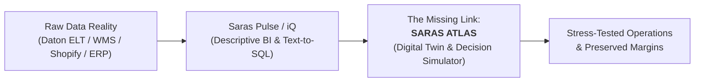

# SARAS ATLAS — EXECUTIVE PRODUCT BRIEF

**Confidentiality & Provenance Notice:**  
*SARAS ATLAS is an independent innovation project. It has not been commissioned, endorsed, or sponsored by Saras Analytics, nor does it access any private Saras systems or proprietary client data. All references to Saras Daton, Pulse, and iQ represent analysis of publicly available product literature, documentation, and market positioning.*

---

## 1. Executive Summary

Modern omnichannel commerce brands operating between $10M and $250M in Gross Merchandise Value (GMV) face an existential vulnerability: **operational fragmentation**. While modern direct-to-consumer (DTC) and retail operators possess sophisticated tools to see what *has already happened* (descriptive analytics) and basic statistical models to estimate *unconstrained future sales* (predictive forecasting), they operate in complete darkness when disruptions strike their physical and financial operations.

When an overseas supplier container is delayed by 21 days, ocean freight or domestic carrier surcharges surge by 30%, and a social media campaign triggers an unpredicted demand spike, the resulting operational shock reverberates across the entire business network. It causes catastrophic stockouts in high-margin distribution centers, strangles working capital, triggers excessive split-shipment fulfillment costs, and collapses net contribution margins.

Today, leadership teams attempt to manage these non-linear disruptions using disconnected spreadsheets, emergency cross-departmental Zoom calls, and gut-feel heuristics.

**SARAS ATLAS** is the **Commerce Resilience & Decision Simulation Platform**—a business digital twin designed specifically for e-commerce and retail leaders. It links inventory, suppliers, warehouses, purchase orders, customer orders, shipping carriers, unit economics, and cash flow into a dynamic, multi-echelon computational graph. 

Instead of merely reporting historical casualties, ATLAS enables founders, CEOs, COOs, and CFOs to:
1. **Detect cascading operational vulnerabilities** before stockouts occur.
2. **Simulate complex, multi-variable counterfactual scenarios** ("What if our Shanghai shipment is delayed 3 weeks AND FedEx adds a peak surcharge AND marketing doubles ad spend on SKU A?").
3. **Compute exact financial consequences** down to SKU-level Contribution Margin and daily Working Capital balances.
4. **Generate mathematically optimal, constraint-aware decision recommendations** (e.g. split-freight reallocations, selective promotional throttling, secondary vendor purchase orders) via mixed-integer linear programming.

---

## 2. The Core Problem Statement

The commerce software ecosystem suffers from a profound architectural divide between **Front-Office Growth Analytics** and **Back-Office Supply Chain Execution**:

1. **The Rear-View Mirror Trap:** Platforms such as Triple Whale, Polar Analytics, Daasity, and Saras Pulse provide high-fidelity reporting on what occurred yesterday or last week (ROAS, CAC, Blended MER, historical orders, historical margin). However, knowing your contribution margin was 22% yesterday does nothing to prevent it from dropping to -4% next month due to supply chain friction.
2. **The Unconstrained Forecasting Fallacy:** Traditional demand forecasting tools predict unconstrained consumer demand assuming infinite inventory and frictionless logistics. In the real world, inventory is constrained across discrete physical locations with lead times, minimum order quantities (MOQs), and cash flow limitations.
3. **The Multi-Million Enterprise Moat:** Enterprise supply chain planning suites (Kinaxis RapidResponse, Blue Yonder, Coupa/LLamasoft) cost upwards of $250,000 to $1,000,000 annually, require 9 to 18-month systems integration cycles, and are built exclusively for Fortune 500 SAP/Oracle environments.
4. **The Mid-Market Vacuum:** Fast-growing omnichannel brands ($10M–$250M GMV) are completely stranded in the middle. They are too complex for Shopify spreadsheets and too agile for SAP, leaving millions of dollars of trapped working capital and preventable stockouts on the table.

---

## 3. Product Vision & Value Proposition

SARAS ATLAS transforms commerce operations from **reactive fire-fighting** into **proactive, evidence-backed decision simulation**.

### Value Proposition Pillars
- **Single Operational Graph (The Commerce Digital Twin):** Unifies multi-echelon physical entities (suppliers, purchase orders, containers, customs checkpoints, 3PL distribution centers, regional inventory tiers, parcel carriers) with financial unit economics (COGS, freight, customs duties, pick/pack fees, payment processing, ad spend, customer returns).
- **Non-Linear Shock Propagation:** Accurately propagates lead-time disruptions and freight rate hikes forward through time, calculating exactly when and where regional stockouts will occur, how fulfillment costs will escalate due to out-of-zone shipping, and the resulting cash-flow crunch.
- **Counterfactual Scenario Studio:** Allows business operators to test "what-if" hypotheses in a sandboxed, zero-risk simulation environment with sub-second recalculation.
- **Deterministic Optimization Engine:** Formulates complex trade-offs into mixed-integer linear programming (MILP) models that find the mathematically proven highest-margin, lowest-risk operational paths under hard cash and capacity constraints.
- **Enterprise-Grade Governance & Human-in-the-Loop:** Provides explainable decision scorecards, comprehensive audit trails, and strict role-based approval controls. ATLAS never executes automated irreversible financial transactions without verified human authorization.

---

## 4. Complementary Alignment with Saras Analytics

SARAS ATLAS is engineered to be the ultimate strategic complement to Saras Analytics' existing product suite:

| Saras Core Product | Primary Purpose | ATLAS Strategic Symbiosis |
| :--- | :--- | :--- |
| **Saras Daton** | Automated ELT data pipelines with 200+ connectors syncing Shopify, Amazon, ERPs, and ad platforms into BigQuery/Snowflake. | **Upstream Feeder:** ATLAS ingests Daton's normalized data tables as its canonical ground truth, eliminating the need to build redundant ingestion connectors. |
| **Saras Pulse** | Curated AI-ready datasets and operational BI dashboards for executive, financial, and marketing reporting. | **Semantic Baseline:** ATLAS consumes Pulse's certified metric definitions (LTV, CAC, Margin) ensuring mathematical consistency across historical and simulated metrics. |
| **Saras iQ & iQ MCP** | Conversational AI analyst querying data warehouses via Anthropic's Model Context Protocol (MCP). | **Decision Execution Surface:** ATLAS exposes its scenario simulation endpoints directly as specialized MCP tools, allowing Claude and executive assistants to run live simulations via natural language. |
| **Forward Deployed Engineering (FDE)** | High-agency technical consultants delivering custom workflows and deployments for enterprise accounts. | **High-Value Client Weapon:** ATLAS gives Saras FDEs a high-impact, proprietary decision platform to deploy for flagship clients (such as Faherty, AG1, and Decathlon) to optimize multi-million-dollar supply chain decisions. |

---

## 5. Flagship Validation Scenario: The Commerce Tri-Disruption

To demonstrate unequivocal commercial and technical value, SARAS ATLAS centers its MVP on an authentic, high-impact flagship scenario:

> **The Flagship Disruption:**
> 1. **Supply Shock:** A core ocean freight container holding 10,000 units of the brand's top-selling apparel SKU is delayed by 21 days due to trans-Pacific port congestion.
> 2. **Cost Shock:** Domestic parcel carriers institute an unexpected 28% peak congestion surcharge on East Coast fulfillment lanes.
> 3. **Demand Shock:** A viral TikTok influencer review drives a 45% demand surge over the next 30 days.

**The ATLAS Response:**
1. **Propagation:** ATLAS detects that West Coast warehouse inventory will deplete in 9 days, forcing East Coast 3PL to fulfill West Coast orders at punitive Zone 8 shipping rates, causing Contribution Margin to plummet from 28% to 6%, while depleting total stock 14 days before the delayed shipment arrives.
2. **Simulation:** ATLAS compares three distinct strategies:
   - *Alternative A (Status Quo / Passive):* Allow stockout; incur $142,000 lost revenue and $38,000 excess cross-zone shipping costs.
   - *Alternative B (Emergency Air Freight):* Air-freight 2,500 units from backup supplier in Vietnam at $12/unit; prevents stockout, preserves $115,000 revenue, but compresses margin by $30,000.
   - *Alternative C (ATLAS Optimal Decision):* Split decision: Air-freight 1,200 units of high-velocity sizes; reallocate 1,500 units from slow-moving European subsidiary; throttle paid ad spend on SKU A by 20% to stabilize burn rate; dynamically re-route remaining orders.
3. **Outcome:** Alternative C preserves $128,000 in revenue, saves $41,000 in avoidable carrier surcharges, and maintains a healthy 21.4% Contribution Margin, requiring zero external funding.

---

## 6. Implementation & Operational Feasibility

- **Budget:** ₹0 (Zero). Built entirely with battle-tested open-source libraries (FastAPI, Next.js, SQLAlchemy, DuckDB, NumPy, Google OR-Tools).
- **Hardware Profile:** Optimized for an 8.0 GB RAM Windows 11 host computer, utilizing an in-process Modular Monolith architecture requiring < 1.0 GB total resident memory.
- **Target Launch:** Fully operational Phase 0 baseline completed; ready for Phase 1 Data Foundation execution.

