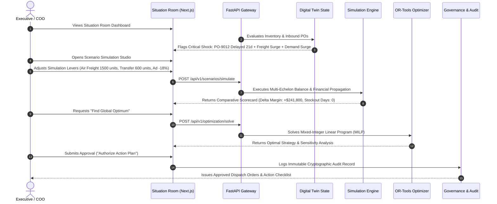

# FINAL PRODUCT SCOPE & MVP ARCHITECTURAL SPECIFICATION

**Document ID:** SCOPE-ATLAS-001  
**Version:** 1.0.0  
**Phase:** Phase 0 Baseline  
**Author:** Autonomous CTO & Principal Product Strategist  

---

## 1. Scope Evaluation Methodology

To build an exceptionally engineered, defensible enterprise platform within a ₹0 budget and an 8.0 GB RAM Windows development environment, we systematically audited all 11 candidate modules proposed for SARAS ATLAS.

We applied three rigid gating principles:
1. **The End-to-End Flagship Imperative:** The MVP must execute the entire flagship disruption workflow—from risk detection to propagation, simulation, optimization, governance, and audit—without manual calculation gaps.
2. **Deterministic Integrity First:** Core calculations must never depend on non-deterministic LLMs or external cloud APIs.
3. **Hardware Boundedness:** The entire system must run with $< 1.0\text{ GB}$ total RAM footprint on the host computer.

---

## 2. Comprehensive Module Evaluation & Triage

```
+---------------------------------------------------------------------------------------+
|                             SARAS ATLAS MODULE ROADMAP                                |
|                                                                                       |
|   [ PHASE 1 MVP (CORE DECISION ENGINE) ]             [ POSTPONED TO PHASE 2 / 3 ]     |
|   --------------------------------------             ----------------------------     |
|   M1: Business Digital Twin (Core Graph)             M9:  AI Specialist Workforce     |
|   M2: Executive Situation Room (Dashboard)                (Multi-Agent Autonomous)    |
|   M3: Operational Risk Detection Engine              M11: Outcome Intelligence        |
|   M4: Impact Propagation Engine (Cascades)                (Longitudinal Drift Tracking)|
|   M5: Predictive Intelligence (Stat Baselines)                                        |
|   M6: Scenario Simulation Studio (Sandbox)                                            |
|   M7: Optimization Engine (OR-Tools MILP)                                             |
|   M8: Evidence & Explainability (Deterministic)                                       |
|   M10: Governance & Human Approval (Audit/RBAC)                                       |
+---------------------------------------------------------------------------------------+
```

### Detailed Module Evaluation

| Module ID | Module Name | Scope Decision | Engineering Justification & Architectural Boundaries |
| :--- | :--- | :---: | :--- |
| **M1** | **Business Digital Twin** | **IN MVP** | **Core Foundation.** Canonical data models representing multi-echelon networks (Suppliers, POs, Warehouses, SKUs, Carriers, Costs). Without this, no simulation is possible. |
| **M2** | **Executive Situation Room** | **IN MVP** | **Primary User Interface.** Provides executive situational awareness, KPI status bars (Days of Coverage, Active Stockouts, Margin at Risk), and interactive network topology map. |
| **M3** | **Operational Risk Detection** | **IN MVP** | **Automated Sentinel.** Evaluates daily operational snapshots against lead-time variances, Days of Coverage (DoC), and carrier lane tariffs to flag emerging vulnerabilities automatically. |
| **M4** | **Impact Propagation Engine** | **IN MVP** | **Core Mathematical Heart.** Propagates upstream shocks forward across multi-period inventory balances, out-of-zone shipping rerouting, Contribution Margin, and cash burn. |
| **M5** | **Predictive Intelligence** | **IN MVP (Scoped)** | **Baseline Demand Modeling.** Scoped to lightweight, deterministic statistical models (Exponential Smoothing, Holt-Winters, seasonal multipliers) running in Python without heavy ML or cloud dependencies. |
| **M6** | **Scenario Simulation Studio** | **IN MVP** | **Interactive Sandbox.** Ephemeral scenario branching allowing operators to manipulate disruption levers (delay days, freight surcharges, demand spikes) and inspect side-by-side comparative scorecards in $< 200\text{ ms}$. |
| **M7** | **Optimization Engine** | **IN MVP** | **Prescriptive Decision Solver.** Mixed-Integer Linear Programming (MILP) formulated in Google OR-Tools to solve optimal inventory reallocations, emergency air shipments, and ad throttling under budget constraints. |
| **M8** | **Evidence & Explainability** | **IN MVP (Deterministic)**| **Enterprise Transparency.** Generates structured executive briefings and mathematical variance decomposition (waterfall attribution) using deterministic template engines at ₹0 token cost. |
| **M9** | **AI Specialist Workforce** | **POSTPONED (Phase 3)** | **Multi-Agent Deliberation.** Multi-agent personas (e.g. simulated "Logistics Director Agent" debating "CFO Agent") introduce non-determinism, excessive RAM consumption, and require paid LLM APIs. Core simulation must be perfected first. |
| **M10** | **Governance & Human Approval**| **IN MVP** | **Enterprise Safety & Control.** Cryptographic audit logs, role-based approval gates (COO/CFO two-man rule), and operational action exports. Zero autonomous financial transactions. |
| **M11** | **Outcome Intelligence** | **POSTPONED (Phase 2)** | **Closed-Loop Drift Tracking.** Compares actual real-world operational results against simulated predictions 30–90 days post-decision. Requires longitudinal operational data streams not available in initial offline rollout. |

---

## 3. The MVP Flagship Workflow (End-to-End)

The Phase 1 MVP delivers a complete, unbroken executive decision lifecycle:



---

## 4. MVP Functional Scope Boundary Matrix

### What is IN Scope for MVP:
1. **Single-Process Modular Architecture:** Fast, unified backend running under Python 3.12 without external server daemons.
2. **Canonical Relational Data Store:** SQLite in WAL mode with complete relational schemas, foreign keys, and indexes, managed via SQLAlchemy 2.0 and Alembic.
3. **In-Process Analytical Acceleration:** DuckDB embedded instance for fast vectorized scenario aggregations.
4. **Three-Tier Multi-Echelon Network:** Factory $\rightarrow$ Overseas Port $\rightarrow$ US Port $\rightarrow$ Regional 3PLs (West Coast, East Coast) $\rightarrow$ Customer Delivery Zones.
5. **Full Unit Economics Pipeline:** Revenue, COGS, Inbound Freight, Tariffs, 3PL In/Out, Carrier Zone Tariffs (Zones 1–8), Ad Spend, and SKU Contribution Margin.
6. **Flagship Scenario Dataset:** Realistic synthetic data generation modeling "Vanguard Apparel Co." with 50 SKUs, 3 warehouses, 180 days of order history, and active disruptions.
7. **Google OR-Tools MILP Solver:** Solves the multi-objective inventory rebalancing and air-freight decision problem in $< 3.0$ seconds.
8. **Interactive Next.js Web UI:** Situation Room, Network Visualizer, Scenario Studio with real-time sliders, and Approval Modal.

### What is OUT of Scope for MVP:
1. Multi-tenant SaaS user management and billing subscriptions (Phase 4).
2. Autonomous write-backs to external Shopify/ERP APIs (Strictly prohibited).
3. Paid LLM API calls or heavy local language model installations.
4. Live automated supplier RFQ email dispatchers.
5. Multi-agent persona debate swarms.

