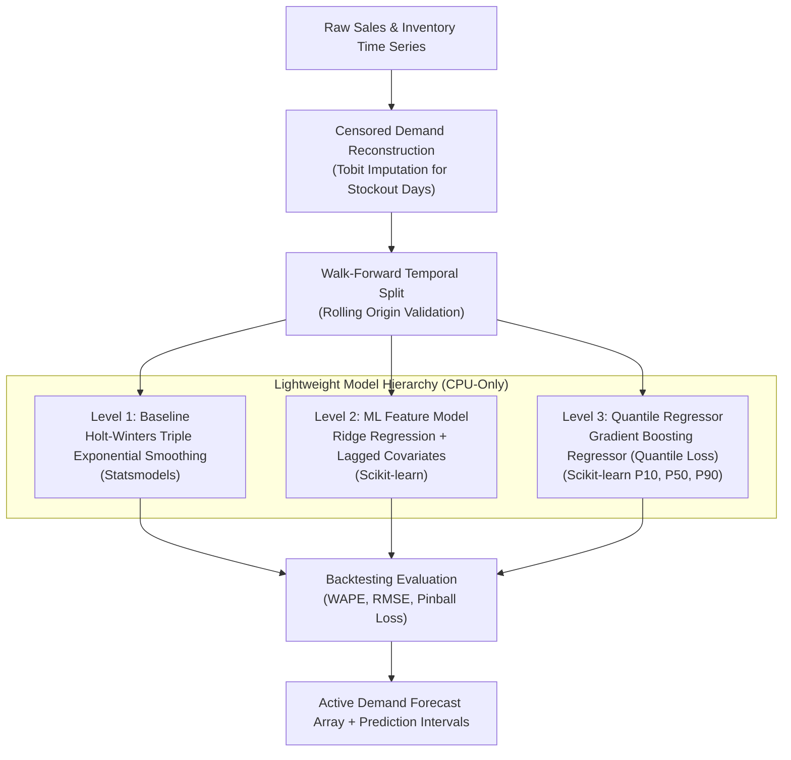

# FORECASTING & MACHINE LEARNING METHODOLOGY

**Document ID:** ML-ATLAS-001  
**Version:** 1.0.0  
**Phase:** Phase 0 Baseline  
**Author:** AI/ML Research Engineer & Principal Data Scientist  

---

## 1. Machine Learning Mandate & Philosophy

In commerce operations, high-complexity deep learning models often fail due to severe non-stationarity, erratic promotional shocks, and over-parameterization. Furthermore, deep neural networks consume massive RAM and GPU resources, violating our 8.0 GB RAM / ₹0 budget constraints.

SARAS ATLAS adopts a **Pragmatic, High-Precision Statistical & ML Framework**:
1. **Lightweight & Interpretable:** Primary reliance on classical statistical time-series models (**Holt-Winters Exponential Smoothing**) and regularized linear/tree models (**Scikit-learn Ridge & Gradient Boosting**).
2. **Censored Demand Reconstruction:** Explicit algorithmic unbiasing to prevent stockout days (zero sales due to zero stock) from polluting future demand forecasts.
3. **Probabilistic Uncertainty Estimation:** Generates explicit prediction intervals (80% and 95% confidence bands) to feed safety stock and stockout risk calculations.
4. **Zero GPU / Low RAM Footprint:** Complete training and inference run on CPU in $< 500\text{ ms}$ consuming $< 45\text{ MB}$ memory.

---

## 2. The Censored Demand Problem in Retail Analytics

A fatal flaw in standard e-commerce BI is treating **observed sales** as **true customer demand**:

```
[ THE CENSORED DEMAND TRAP ]

Day:               Day 1    Day 2    Day 3    Day 4 (STOCKOUT)  Day 5 (STOCKOUT)
True Demand:        150      145      160          175               180
On-Hand Stock:      500      350      190           0                 0
Observed Sales:     150      145      160           0                 0
                                                    ^                 ^
Naive Forecast sees: "Demand dropped to ZERO! Cut future orders!"
Reality: Demand was surging, but inventory was completely exhausted!
```

### Censored Demand Reconstruction Algorithm
SARAS ATLAS reconstructs latent unobserved demand $\hat{D}_{i,w}(t)$ on stockout days:

$$\hat{D}_{i,w}(t) = \begin{cases} 
S_{i,w}(t) & \text{if } I_{i,w}(t-1) > 0 \text{ (Uncensored)} \\ 
\max\left(S_{i,w}(t), \; \bar{D}_{i, \text{uncensored}} \cdot S_{\text{day}}(t) \cdot S_{\text{promo}}(t)\right) & \text{if } I_{i,w}(t-1) = 0 \text{ (Censored)} 
\end{cases}$$

Where $\bar{D}_{i, \text{uncensored}}$ is estimated via **Tobit Regression (Censored Normal Regression)** fitted on historical uncensored periods.

---

## 3. Forecasting Models & Hierarchy



### 3.1 Level 1: Holt-Winters Triple Exponential Smoothing (Default Engine)
Fitted via `statsmodels.tsa.holtwinters.ExponentialSmoothing`:
$$\hat{y}_{t+h} = \left(\ell_t + h b_t\right) s_{t+h-m(k+1)}$$
Where:
- $\ell_t$: Level component with smoothing parameter $\alpha$.
- $b_t$: Additive trend component with smoothing parameter $\beta$.
- $s_t$: Multiplicative seasonal component with weekly cycle $m=7$ and parameter $\gamma$.
- **Advantages:** Runs in $< 15\text{ ms}$ per SKU; highly robust for weekly retail cycles; requires zero external feature engineering.

### 3.2 Level 2: Regularized ML Lag Model (Scikit-learn Ridge)
For SKUs with strong marketing spend interactions:
$$y_t = \sum_{k=1}^7 w_k y_{t-k} + \sum_{j=1}^3 \theta_j \text{AdSpend}_{t-j} + \delta_{\text{dow}} + \epsilon_t$$
Fitted with L2 regularization ($\lambda = 1.0$) to prevent overfitting on short time horizons.

### 3.3 Level 3: Quantile Regression for Demand Uncertainty
To quantify downside and upside inventory risk, SARAS ATLAS uses `HistGradientBoostingRegressor(loss="quantile")` from Scikit-learn to estimate:
- **P10 (Low Demand Scenario):** 10th percentile demand.
- **P50 (Median Expected Demand):** Base planning forecast.
- **P90 (High Demand Scenario):** Upper bound used for safety stock sizing.

---

## 4. Backtesting Methodology & Validation Metrics

To prevent data leakage, SARAS ATLAS strictly forbids random K-Fold cross-validation. All models are evaluated via **Walk-Forward Rolling-Origin Validation**:

```
Fold 1: [--- Train: Days 1 to 90 ---] [ Val: Days 91 to 104 ]
Fold 2: [--- Train: Days 1 to 104 --] [ Val: Days 105 to 118 ]
Fold 3: [--- Train: Days 1 to 118 --] [ Val: Days 119 to 132 ]
```

### Evaluation Metrics
1. **Weighted Absolute Percentage Error (WAPE):**  
   Primary retail metric (avoids division by zero during low-volume days):
   $$\text{WAPE} = \frac{\sum_{t=1}^T |y_t - \hat{y}_t|}{\sum_{t=1}^T y_t}$$
   *Acceptance Threshold:* $\text{WAPE} \le 18.0\%$ on core SKUs.
2. **Root Mean Squared Error (RMSE):**  
   Penalizes large forecast errors that cause extreme stockouts.
3. **Pinball Loss (Quantile Loss at $\tau \in \{0.10, 0.90\}$):**  
   Evaluates prediction interval coverage and sharpness.

---

## 5. Elasticity & Marketing Shock Modeling

When the user manipulates the "Demand Shock Slider" ($\alpha \in [0.5, 3.0]$) in the Scenario Studio, the forward demand vector is perturbed:

$$D_{\text{sim}}(t) = \hat{D}_{\text{base}}(t) \cdot \left[1 + (\alpha - 1) \cdot e^{-\lambda (t - t_{\text{shock}})}\right]$$

Where:
- $\alpha$: Shock magnitude (e.g. $1.45$ for a +45% viral TikTok surge).
- $\lambda$: Half-life decay parameter (modeling the natural decay of social media virality over a 30-day window, $\lambda \approx 0.05$).
- Ensures realistic demand curve shapes rather than unphysical infinite step-functions.

