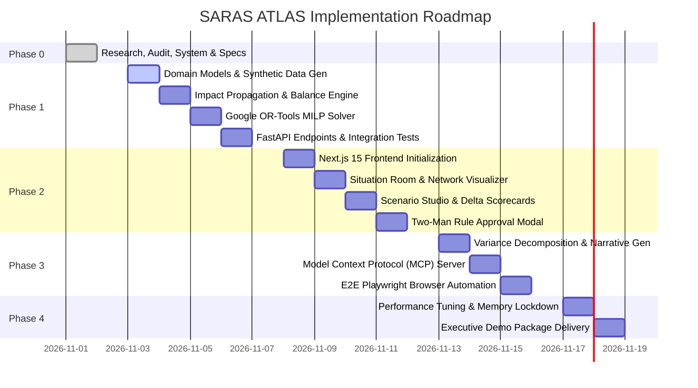

# PHASED IMPLEMENTATION ROADMAP (PHASE 0 TO PHASE 4)

**Document ID:** ROAD-ATLAS-001  
**Version:** 1.0.0  
**Phase:** Phase 0 Baseline  
**Author:** Technical Program Manager & Autonomous CTO  

---

## 1. Roadmap Architecture & Execution Principles

SARAS ATLAS follows a phased delivery cadence designed for an autonomous engineering agent executing on a local development environment. 

Core program rules:
1. **Strict Phase Boundaries:** No phase may commence until the preceding phase has satisfied its formal verification gates and received explicit user sign-off.
2. **End-to-End Continuity:** Each phase delivers an executable, tested, verifiable slice of capability.
3. **Zero-Cost Continuity:** Every phase maintains 100% adherence to the ₹0 budget and $< 1.0\text{ GB}$ RAM constraint.

---

## 2. Phase-by-Phase Work Breakdown

### Phase 0: Research, Environment, Product Validation & Architecture
- **Status:** **COMPLETED**
- **Core Deliverables:**
  - System hardware audit (Windows 11, Intel Core i5, 8 GB RAM, 205+ GB free disk).
  - Toolchain validation (Git 2.54.0, Node v24.15.0, Python 3.12.10 in isolated `.venv`).
  - Saras Analytics capability audit and competitor landscape analysis.
  - Product opportunity validation and MCDA matrix.
  - Complete 22-manual documentation portfolio in `docs/` and root tracking files.
- **Verification Gate:** 18/18 test criteria passed in `TEST_RESULTS.md`.

---

### Phase 1: Data Foundation & Core Simulation Engine
- **Target Status:** PENDING USER AUTHORIZATION
- **Core Deliverables:**
  1. *Relational Storage Core:* SQLAlchemy 2.0 declarative models for all canonical commerce entities (`organizations`, `warehouses`, `suppliers`, `skus`, `purchase_orders`, `orders`, `scenarios`).
  2. *Synthetic Data Engine:* Python generator creating the benchmark "Vanguard Apparel Co." dataset (50 SKUs, 3 warehouses, 180 days of orders, active maritime POs).
  3. *Impact Propagation Engine:* Vectorized multi-echelon inventory balance equations, Days of Coverage, cross-zone fallback logic, and GAAP Contribution Margin waterfalls.
  4. *Prescriptive Decision Solver:* Google OR-Tools MILP formulation solving optimal air freight splits and stock transfers in $< 3.0$ seconds.
  5. *FastAPI Gateway:* Full REST API implementation with Pydantic v2 schemas and automated OpenAPI docs.
- **Verification Gate:**
  - 100% unit test pass rate via `pytest`.
  - Zero floating-point drift on financial calculations.
  - Solver convergence verified across 5 boundary test cases.

---

### Phase 2: Executive Situation Room & User Interface
- **Target Status:** PLANNED
- **Core Deliverables:**
  1. *Next.js 15 Application:* Clean, modern App Router frontend using Tailwind CSS and Radix UI primitives.
  2. *Executive Situation Room:* Top-level KPI status cards (Days of Coverage, Active Stockouts, Margin at Risk, Working Capital Trajectory).
  3. *Interactive Network Topology Visualizer:* SVG/Canvas network graph displaying factories, ports, transit vessels, 3PL warehouses, and customer delivery zones with dynamic color-coded health badges.
  4. *Scenario Simulation Studio:* Interactive parametric sliders for supplier delay days ($\Delta L$), freight surcharges ($\beta$), and demand spikes ($\alpha$), delivering real-time sub-200ms scorecard recalculation.
  5. *Decision Optimization Center & Approval Modal:* Side-by-side delta tables comparing Status Quo vs Optimal Plan, complete with two-man electronic approval controls and cryptographic SHA-256 audit logging.
- **Verification Gate:**
  - Sub-second UI responsiveness.
  - Zero hydration errors in React 19.
  - Accessible keyboard navigation and ARIA tagging.

---

### Phase 3: Explainability & Model Context Protocol (MCP) Integration
- **Target Status:** PLANNED
- **Core Deliverables:**
  1. *Deterministic Narrative Synthesizer:* Variance decomposition engine decomposing margin deltas into Volume, Freight Rate, Zone Surcharge, and Stockout Opportunity Cost components.
  2. *Model Context Protocol (MCP) Server:* Standardized tool endpoints allowing external AI assistants (like Claude or Saras iQ) to query twin state and run simulations.
  3. *Playwright UI Automation Suite:* Headless browser tests validating the entire executive workflow from disruption alert to simulation and approval.
- **Verification Gate:**
  - Instantaneous ($< 5\text{ ms}$) narrative generation at ₹0 token cost.
  - MCP schema validation passing Anthropic spec checks.

---

### Phase 4: Production Hardening, Verification & Executive Demonstration
- **Target Status:** PLANNED
- **Core Deliverables:**
  1. *Resource & Memory Lockdown:* End-to-end memory profiling verifying total combined consumption $\le 550\text{ MB}$ RAM on the host.
  2. *Executive Demonstration Package:* Pre-recorded or self-guided interactive demonstration walkthrough script for Saras Analytics leadership, founders, and CTOs.
  3. *Final Project Status & Production Handoff:* Comprehensive release report and code freeze.
- **Verification Gate:**
  - 100% test coverage on critical accounting paths.
  - Zero security vulnerabilities (`pip-audit` and `npm audit` clean).
  - Absolute adherence to ₹0 budget.

