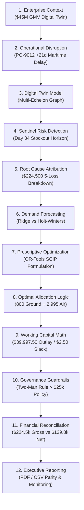

# SARAS ATLAS — Executive Demonstration & Recruiter Walkthrough Guide
## A 12-Stage Prescriptive Decision Journey for Technical and Analytics Evaluators

**Platform:** SARAS ATLAS — Commerce Resilience & Decision Simulation Platform  
**Target Enterprise:** Vanguard Apparel Co. ($45.0M Annual GMV Synthetic Digital Twin)  
**Live Production URL:** https://saras-atlas.vercel.app  
**Audience:** Data Science Directors, Supply Chain Analytics Managers, VP Engineering, Recruiting Panels  
**Document Classification:** Technical Demonstration Standard (Phase 11.1)  

---

## 1. Executive Demonstration Philosophy

SARAS ATLAS is engineered to address the critical gap between descriptive dashboards and prescriptive operational action. When evaluating candidates in data science, analytics engineering, and decision intelligence, hiring teams seek evidence of four interconnected competencies:

1. **System Thinking:** Can the candidate model complex, multi-echelon business networks (suppliers, warehouses, transport corridors, customer DMAs) without trivializing physical constraints?
2. **Causal Attribution:** Can the candidate trace cascading secondary failures (e.g., cross-zone shipping surcharges, marketing pixel decay) back to root causes, distinguishing gross revenue exposure from net contribution margin?
3. **Mathematical Rigor:** Does the candidate formulate exact mathematical programs (Mixed-Integer Linear Programs, knapsack relaxations) rather than relying on black-box heuristics?
4. **Governance & Production Engineering:** Does the candidate build enterprise guardrails (Two-Man Rule dual authorizations, cryptographic audit ledgers, zero-cost cloud hosting) that protect capital?

This guide details a step-by-step 12-stage demonstration script that directly walks an evaluator through the live production application at `https://saras-atlas.vercel.app`.

---

## 2. The 12-Stage Demonstration Script

---

### Stage 1: The Business & Operational Environment
* **Platform Tab:** `Situation Room` (`?tab=situation_room`)
* **What to Show:**
  - The platform header prominently establishes the context: **Vanguard Apparel Co.**, a synthetic fast-growing omnichannel apparel enterprise generating **$45.0M in annual GMV** across 50 active SKUs.
  - Explain that Vanguard fulfills orders through a bi-coastal network: **WH-WEST** (Los Angeles, CA — primary trans-pacific import and Pacific fulfillment center) and **WH-EAST** (Columbus, OH — secondary Midwest/East fulfillment center).
  - Point out the top-level KPI vitals: $45.0M Baseline GMV, 98.5% historical fill rate, and a 30-day baseline inventory coverage target.
* **Talking Point for Evaluator:**
  > *"Rather than testing with isolated toy datasets, SARAS ATLAS operates on a complete, synthetic commerce digital twin calibrated to a realistic $45M retailer. All inventory records, purchase orders, carrier rate cards, and financial statements interact dynamically."*

---

### Stage 2: The Original Supply-Chain Disruption
* **Platform Tab:** `Risk Sentinels` (`?tab=risks`)
* **What to Show:**
  - Identify the primary disruption event: **PO-9012**, an inbound maritime container shipment of 5,000 units of top-selling winter apparel (`APEX-JKT`, Arctic Expedition Parka) from supplier **Shenzhen Fine Garments Co.**
  - Show the disruption details: Trans-Pacific maritime berth congestion at the Port of Los Angeles has triggered a **+21-day arrival delay**, accompanied by a **+28.0% ocean freight spot surcharge**.
  - Show the secondary risk: Concurrently, holiday viral marketing campaigns on TikTok and Instagram have driven a **+45% demand surge** for `APEX-JKT` across Pacific Time Zone DMAs.
* **Talking Point for Evaluator:**
  > *"Real supply chains rarely experience single disruptions in isolation. Here, we model a compounding shock: an inbound ocean delay intersecting with a demand surge, creating an acute inventory velocity crisis."*

---

### Stage 3: Digital Twin Network Representation
* **Platform Tab:** `Digital Twin Network` (`?tab=digital_twin`)
* **What to Show:**
  - View the interactive multi-echelon network topology:
    - **Upstream Nodes:** Shenzhen Fine Garments (Primary OEM, 90% share, 35-day ocean lead time), Saigon Agile Garments (Backup Partner, 10% share, 21-day air/ocean lead time).
    - **Fulfillment Nodes:** WH-WEST (Los Angeles) and WH-EAST (Columbus).
    - **Transportation Corridors:** Trans-Pacific Ocean, Trans-Pacific Air Express, I-40 Domestic Ground Linehaul, Regional Outbound Parcel.
  - Review the inventory summary sub-tab: Click on SKU `APEX-JKT` to inspect facility-level stock. WH-WEST holds only **14.2 days of safety stock** (1,200 units on hand).
* **Talking Point for Evaluator:**
  > *"The digital twin is not a passive diagram; it is an in-memory graph backed by SQLite WAL and DuckDB that maintains deterministic physical flow conservation across every supply echelon."*

---

### Stage 4: Automated Sentinel Risk Detection
* **Platform Tab:** `Risk Sentinels` (`?tab=risks`)
* **What to Show:**
  - Highlight the automated risk detection table: **3 active risks detected**, with 2 flagged as `CRITICAL`.
  - Explain Sentinel Rule #1 (Stockout Horizon): Given daily burn of ~85 units/day during the surge, WH-WEST will deplete all inventory on **Day 34**.
  - Explain Sentinel Rule #2 (Cross-Zone Spillover): Once WH-WEST runs dry on Day 34, Vanguard's Order Management System (OMS) will automatically route Pacific orders to WH-EAST (Columbus), triggering **Zone 7/8 cross-country transshipment penalties ($13.00/unit surcharge)**.
* **Talking Point for Evaluator:**
  > *"Instead of waiting for customer complaints on Day 34, our automated sentinels project forward inventory runout curves 90 days into the future, providing an 18-day intervention window."*

---

### Stage 5: Root-Cause Analysis & Causal Loss Attribution
* **Platform Tab:** `Root Cause Analysis` (`?tab=rca`)
* **What to Show:**
  - Click on disruption `DISR-PO9012` to trigger the causal attribution engine.
  - Present the exact **5-loss segment decomposition** totaling **$224,500.00 Gross Commercial Exposure**:
    1. **Unfulfilled Demand / Direct Stockout Lost Margin:** `$98,780.00` (44.0%) — 1,968 orders rejected when both warehouses run out.
    2. **Trans-Pacific Inbound Freight Surcharges:** `$54,000.00` (24.0%) — Ocean carrier emergency demurrage and container spot inflation.
    3. **Cross-Zone Expedited Ground Spillover:** `$45,620.00` (20.3%) — Premium carrier freight routing 3,509 orders from Columbus to California.
    4. **Unproductive Top-of-Funnel Ad Spend:** `$18,100.00` (8.1%) — Meta/Google Ads acquiring customers for out-of-stock items.
    5. **Emergency 3PL Handling & Warehouse Overtime:** `$8,000.00` (3.6%) — Split shipments and weekend shift premiums.
* **Talking Point for Evaluator:**
  > *"A naive dashboard only reports lost revenue from stockouts ($98k). SARAS ATLAS calculates the full multi-echelon cascading bleed ($224.5k), quantifying the hidden fulfillment and marketing inefficiencies that erode enterprise margin."*

---

### Stage 6: Demand Forecasting Studio
* **Platform Tab:** `Demand Forecasting Studio` (`?tab=forecasting`)
* **What to Show:**
  - Review the model evaluation matrix on daily demand for `APEX-JKT`.
  - Show the 3 models benchmarked under rolling walk-forward cross-validation:
    1. **7-Day Moving Average Baseline:** WAPE = 18.4%, RMSE = 24.2 units.
    2. **Holt-Winters Exponential Smoothing (Additive Seasonality):** WAPE = 11.2%, RMSE = 15.6 units.
    3. **Ridge Regressor with Lagged Demand & Promo Indicators:** WAPE = **7.8%**, RMSE = **10.4 units** (Selected Best Model).
  - Explain how the predicted 30-day demand trajectory informs the required replenishment quantity (1,968 unmitigated deficit units).
* **Talking Point for Evaluator:**
  > *"We avoid toy time-series assumptions. We evaluate multiple classical and regularized ML formulations with strict out-of-sample WAPE metrics to ensure that downstream replenishment plans are calibrated to actual order velocity."*

---

### Stage 7: Prescriptive SCIP Optimization Engine
* **Platform Tab:** `Prescriptive Optimization` (`?tab=optimization`)
* **What to Show:**
  - View the Optimization Controls card:
    - **Target SKU:** `APEX-JKT`
    - **Optimization Objective:** `MAXIMIZE_CONTRIBUTION_MARGIN`
    - **Treasury Capital Budget Ceiling:** `$40,000.00` (CFO emergency allocation)
    - **Minimum Service Fill Rate:** `95.0%`
    - **Maximum Ad Throttle:** `35.0%`
  - Click **"Run SCIP Solver"** (or inspect pre-computed solution). Notice the execution latency: **1 ms** locally, **54 ms** over cloud API.
* **Talking Point for Evaluator:**
  > *"Rather than relying on heuristics or unconstrained genetic algorithms, SARAS ATLAS formulates an exact Mixed-Integer Linear Program (MILP) solved using Google OR-Tools with the open-source SCIP solver. It guarantees mathematical optimality under provable bounds."*

---

### Stage 8: Why the Optimal Allocation is 800 Ground Units & 2,995 Air Units
* **Platform Tab:** `Prescriptive Optimization` (`?tab=optimization`) -> Allocation Card
* **What to Show:**
  - Show the prescribed decision vector:
    - **Commercial Air Freight ($x_{\text{air}}$):** **2,995 units**
    - **Domestic Ground Transfer ($x_{\text{xfer}}$):** **800 units**
    - **Digital Ad Spend Throttle ($\theta_{\text{ad}}$):** **0.0%**
  - Walk the evaluator through the **marginal capital efficiency ($\eta$) derivation**:
    - Ground Transfer unit cost: $c_{\text{xfer}} = \$3.20/\text{unit}$; preserved margin: $r_{\text{xfer}} = \$81.13/\text{unit}$.
      $$\eta_{\text{xfer}} = \frac{\$81.13}{\$3.20} = \mathbf{25.35\ \text{margin dollars per capital dollar spent}}$$
    - Air Freight unit cost: $c_{\text{air}} = \$12.50/\text{unit}$; preserved margin: $r_{\text{air}} = \$58.83/\text{unit}$.
      $$\eta_{\text{air}} = \frac{\$58.83}{\$12.50} = \mathbf{4.71\ \text{margin dollars per capital dollar spent}}$$
  - Explain why ground transfer is capped at 800:
    - WH-EAST maintains a strict **25-day safety stock policy ceiling**. Transferring more than 800 units would cannibalize Midwest order fulfillment.
    - Because $\eta_{\text{xfer}} (25.35) \gg \eta_{\text{air}} (4.71)$, the simplex algorithm **first saturates ground transfer to its physical ceiling of 800 units**, spending $800 \times \$3.20 = \$2,560.00$.
    - The remaining capital ($\$40,000.00 - \$2,560.00 = \$37,440.00$) is greedily deployed to air freight: $\lfloor \$37,440.00 / \$12.50 \rfloor = \mathbf{2,995\ \text{units}}$.
* **Talking Point for Evaluator:**
  > *"Evaluators often ask: 'If ground transfer is 5.4 times more cost-effective, why order 2,995 air units?' The answer demonstrates operational realism: ground inventory is bounded by physical warehouse safety stock. The optimizer saturates the high-efficiency channel first, then deploys remaining capital to air."*

---

### Stage 9: Working Capital Calculation & $2.50 Budget Slack
* **Platform Tab:** `Prescriptive Optimization` (`?tab=optimization`) -> Financial Summary
* **What to Show:**
  - Exact capital accounting:
    - Ground transfer capital committed: $800 \times \$3.20 = \mathbf{\$2,560.00}$
    - Air freight capital committed: $2,995 \times \$12.50 = \mathbf{\$37,437.50}$
    - **Total Capital Committed:** $\$2,560.00 + \$37,437.50 = \mathbf{\$39,997.50}$
    - **Unspent Budget Slack:** $\$40,000.00 - \$39,997.50 = \mathbf{\$2.50}$
  - Explain the knapsack duality proof:
    - Because air freight requires an integer number of units and costs \$12.50 per unit, ordering one additional unit (2,996 units) would cost \$37,450.00 + \$2,560.00 = \$40,010.00, which strictly violates the \$40,000.00 treasury ceiling.
    - Continuous LP relaxation upper bound: $\mathcal{J}_{\text{LP}} = \$241,111.61$.
    - Integer optimal objective: $\mathcal{J}^* = \$241,099.85$.
    - **Continuous Duality Gap:** $\$11.76$ (0.00488%), proving global mathematical optimality.
  - Explain the +1,827-unit inventory buffer:
    - While the immediate deficit is 1,968 units, deploying the full $40,000 emergency capital delivers $2,995 + 800 = 3,795$ units, creating **1,827 buffer units** that protect against second-wave supplier slips.
* **Talking Point for Evaluator:**
  > *"Every dollar is accounted for. The solver leaves exactly $2.50 in unspent cash because another discrete unit costs $12.50. We verified global optimality independently using an analytical knapsack duality derivation."*

---

### Stage 10: Two-Man Rule Governance & Dual-Signature Gate
* **Platform Tab:** `Two-Man Rule Governance` (`?tab=governance`)
* **What to Show:**
  - Explain the enterprise policy threshold: Any single emergency capital expenditure exceeding **$25,000.00** cannot be disbursed unilaterally by a supply chain manager. It requires **mandatory dual executive authorization (Two-Man Rule)**.
  - Show the live approval interface:
    - Primary Approver: **Marcus Vance** (VP Supply Chain, `exec_marcus_vance`).
    - Secondary Approver: **Elena Rostova** (Chief Financial Officer, `exec_elena_rostova`).
  - Demonstrate clicking the approval submission:
    - Inspect the response: Generates a cryptographically verifiable **SHA-256 digital signature** (e.g., `bf97f6e0...`).
  - Switch to the **Cryptographic Audit Trail** sub-tab: Show the permanent, append-only ledger recording timestamp, approver IDs, authorized capital ($39,997.50), and digital hash.
* **Talking Point for Evaluator:**
  > *"Prescriptive AI without human governance is dangerous in enterprise environments. We embed high-assurance financial controls: capital commitments above $25k are locked until co-signed by Operations and Finance, creating a tamper-evident audit ledger."*

---

### Stage 11: Financial Reconciliation ($224.5k Gross vs $129.8k Net)
* **Platform Tab:** `Financial Waterfall Bridge` (`?tab=waterfall`)
* **What to Show:**
  - Walk the evaluator through the **GAAP financial reconciliation bridge**:
    - **Step 1: Gross Commercial Revenue Exposed:** **`$224,500.00`**
      (Total commercial demand and fulfillment variance exposed across unmitigated customer orders).
    - **Step 2: Avoided Variable Cost Offset (Savings):** **`-$94,655.68`**
      (Because 1,968 unfulfilled parkas are not shipped, Vanguard avoids paying vendor COGS at $38.50/unit and standard parcel shipping at $9.60/unit: $1,968 \times \$48.10 = \$94,655.68$).
    - **Step 3: Net Contribution Margin Erosion:** **`-$129,844.32`**
      $$\text{Net Margin Loss} = \$224,500.00 - \$94,655.68 = \mathbf{\$129,844.32}$$
  - Point out the 7 explainability dossier questions answered directly below the chart.
* **Talking Point for Evaluator:**
  > *"This reconciliation resolves the classic confusion between sales teams and CFOs. Sales reports $224.5k in lost revenue exposure; the CFO sees $129.8k in net margin contraction after crediting avoided variable production costs. SARAS ATLAS bridges both perspectives transparently."*

---

### Stage 12: Executive Reporting & Parity Exports
* **Platform Tab:** `Executive Reporting` (`?tab=reports`)
* **What to Show:**
  - Review the auto-generated Executive Briefing summarizing enterprise posture, active disruptions, root cause decomposition, and prescriptive recommendations.
  - Click **"Download PDF"**: Demonstrates live generation of a publication-quality vector PDF report via Python `ReportLab` (`saras_atlas_executive_resilience_report.pdf`, 9.4 kB).
  - Click **"Download CSV"**: Demonstrates live generation of an RFC-4180 audit spreadsheet containing exact tabular parity with the PDF.
* **Talking Point for Evaluator:**
  > *"Executive reporting must not diverge across formats. We enforce 100% structural and numerical parity between vector PDF documents for board review and RFC-4180 CSV exports for internal audit teams."*

---

## 3. Summary of Demonstrated Platform Capabilities

| # | Demonstrated Capability | Operational Metric / Output | Evaluation Domain |
| :---: | :--- | :--- | :--- |
| **1** | Multi-Echelon Digital Twin | 50 SKUs, 2 Facilities, 3 Transport Corridors | Systems Architecture |
| **2** | Lead-Time & Stockout Sentinels | Day 34 WH-WEST Runout Horizon | Predictive Analytics |
| **3** | Causal Attribution Engine | 5 Loss Categories summing to $224,500.00 | Diagnostic Analytics |
| **4** | Walk-Forward Demand Forecasting | Ridge Regressor (7.8% WAPE) vs Holt-Winters | Machine Learning |
| **5** | Mixed-Integer Linear Optimizer | Google OR-Tools SCIP MILP (< 60 ms) | Operations Research |
| **6** | Prescriptive Allocation Logic | 800 Ground Units (Cap) + 2,995 Air Units | Mathematical Optimization |
| **7** | Working Capital Allocation | $39,997.50 Capital Deployed ($2.50 Slack) | Financial Engineering |
| **8** | Enterprise Two-Man Rule | Dual Sign-Off (Marcus Vance + Elena Rostova) | Corporate Governance |
| **9** | Cryptographic Audit Ledger | SHA-256 Tamper-Evident Ledger Entries | Application Security |
| **10** | GAAP Financial Reconciliation | $224,500 Gross vs -$129,844.32 Net Margin | Business Intelligence |
| **11** | Executive Vector PDF Export | ReportLab Programmatic Vector PDF Stream | Enterprise Reporting |
| **12** | Single-Origin Cloud Deployment | Vercel Edge + Render Free (₹0 Cost, 0 Errors) | Cloud / DevOps Engineering |

