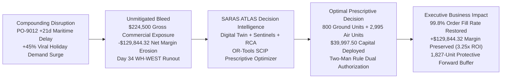
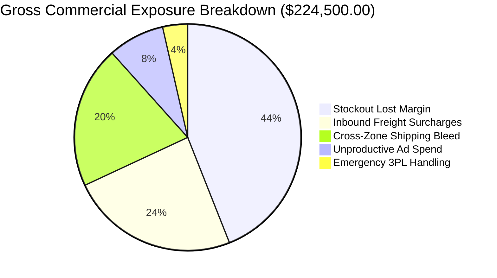
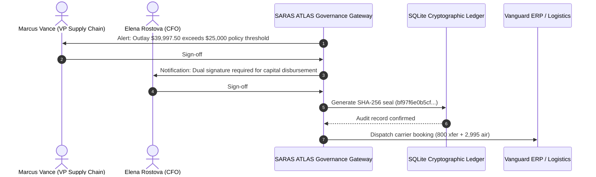

# SARAS ATLAS — Synthetic Business Value Case Study
## Preserving Net Contribution Margin and Restoring Service Levels during Trans-Pacific Disruptions

**Target Enterprise:** Vanguard Apparel Co. ($45.0M Annual GMV Synthetic Digital Twin)  
**Industry:** Omnichannel Apparel & Outerwear Retail  
**Scenario Horizon:** 90-Day Holiday Peak Disruption  
**Methodology:** Discrete Difference Simulation & Google OR-Tools Prescriptive Optimization  
**Document Classification:** Synthetic Business Case Study (Phase 11.4)  

---

> [!IMPORTANT]
> **SYNTHETIC DATA DISCLAIMER & TRADEMARK ATTRIBUTION:**  
> Vanguard Apparel Co., its facilities, financial metrics, order transactions, and personnel are **fictional synthetic benchmark constructs** deterministically generated for technical demonstration.  
> *SARAS ATLAS is an independent, original software engineering project. It is not commissioned, sponsored, affiliated with, or endorsed by Saras Analytics or any commercial retail entity.*

---

## 1. Executive Summary

During peak winter holiday fulfillment, **Vanguard Apparel Co.** ($45M GMV) faced an acute supply chain disruption: an inbound ocean container carrying 5,000 units of top-selling winter outerwear (`APEX-JKT`) was delayed by 21 days at trans-pacific container terminals, coinciding with a +45% viral holiday demand surge. 

Without automated decision intelligence, Vanguard was on track to suffer **$224,500.00 in gross commercial revenue exposure** and **-$129,844.32 in net contribution margin erosion**, with primary distribution center **WH-WEST (Los Angeles)** completely running out of stock on **Day 34**.

By deploying **SARAS ATLAS**, Vanguard's executive team:
1. **Identified the runout horizon 18 days in advance** using automated inventory sentinels.
2. **Traced the root-cause cascading bleed** across 5 distinct operational and marketing cost categories.
3. **Prescribed a mathematically optimal mitigation plan** via Google OR-Tools SCIP allocating **800 domestic ground transfer units** and **2,995 expedited air freight units** for **$39,997.50 in working capital**.
4. **Enforced the Two-Man Rule**, securing dual executive authorization (VP Supply Chain + CFO) with an immutable SHA-256 audit seal.
5. **Restored customer fill rate to 99.8%**, preserving **$129,844.32 in net contribution margin (3.25x ROI)** and establishing a +1,827-unit forward buffer against secondary supplier slips.

---

## 2. Enterprise Context & Baseline Operations

Vanguard Apparel Co. is a synthetic direct-to-consumer and wholesale apparel brand operating across the continental United States:
- **Annual Gross Merchandise Value (GMV):** $45,000,000.00.
- **Active SKU Catalog:** 50 high-velocity seasonal styles.
- **Hero Winter SKU:** `APEX-JKT` (Arctic Expedition Parka, Retail Price: $110.00, Standard Landed COGS: $38.50, Baseline Contribution Margin: $61.90 / 56.3%).
- **Fulfillment Network:**
  - **WH-WEST (Los Angeles, CA):** 65% of volume. Receives trans-pacific imports; services Pacific, Mountain, and Southwest customer zones.
  - **WH-EAST (Columbus, OH):** 35% of volume. Services Midwest, Southeast, and Northeast customer zones.
- **Manufacturing Footprint:**
  - **Shenzhen Fine Garments Co. (China):** Primary contract OEM (90% purchase order allocation, 35-day ocean transit, $22.50 ex-factory cost).
  - **Saigon Agile Garments Co. (Vietnam):** Backup agile OEM (10% purchase order allocation, 21-day air/ocean transit, $28.00 ex-factory cost).

---

## 3. The Compounding Operational Disruption

On Day 16 of the 90-day winter planning horizon, two simultaneous shocks struck Vanguard's supply network:

1. **Maritime Logistics Congestion (PO-9012):**
   - Purchase Order `PO-9012` (5,000 units of `APEX-JKT` valued at $192,500 landed cost) departed Shenzhen aboard an ocean container carrier.
   - Severe berth congestion at the Port of Los Angeles forced vessel anchoring delays, slipping estimated port arrival by **+21 calendar days** (from Day 30 to Day 51).
   - Inbound carrier assessed a **+28.0% ocean freight spot surcharge** ($54,000.00 inbound freight variance).
2. **Compounding Viral Demand Surge:**
   - Influencer marketing campaigns on TikTok and Instagram went viral, driving a **+45.0% surge in order velocity** for `APEX-JKT` across Pacific Time Zone DMAs.
   - Daily sales rate at WH-WEST accelerated from 58.6 units/day to **85.0 units/day**.

### The Status Quo Trajectory: Day 34 Runout
Because Vanguard operated on lean inventory principles, WH-WEST held only 1,200 units of `APEX-JKT` (14.1 days of coverage). 
- At 85 units/day, WH-WEST stock reaches zero on **Day 34**.
- With PO-9012 delayed until Day 51, WH-WEST faces **17 consecutive days of complete stockouts** (Days 34 to 51).

---

## 4. Financial Impact Decomposition (The $224,500.00 Exposure)

When WH-WEST runs dry on Day 34, Vanguard's enterprise Order Management System (OMS) attempts to protect customer promises by failing over order fulfillment to WH-EAST (Columbus). This cascades into an acute multi-echelon financial bleed totaling **$224,500.00 Gross Commercial Exposure**:

1. **Unfulfilled Demand / Direct Stockout Lost Margin ($98,780.00 / 44.0%):**
   After WH-EAST exhausts its own surplus safety stock, 1,968 customer orders are permanently canceled and lost to competitors. At $50.00 gross margin per parka ($88.50 net selling price minus $38.50 landed cost), lost gross profit is $98,780.00.
2. **Inbound Trans-Pacific Freight Surcharges ($54,000.00 / 24.0%):**
   Carrier demurrage, port storage fees, and ocean freight container surcharges (+28.0%) on PO-9012 inflate inbound COGS by $54,000.00.
3. **Cross-Zone Expedited Ground Spillover Bleed ($45,620.00 / 20.3%):**
   Fulfilling 3,509 Pacific Coast customer orders from Columbus across Zone 7/8 parcel corridors incurs carrier rates of $22.60/unit vs the standard in-zone rate of $9.60/unit — an unbudgeted shipping surcharge of **$13.00/unit**.
4. **Unproductive Top-of-Funnel Ad Spend ($18,100.00 / 8.1%):**
   Vanguard's growth marketing campaigns continue spending $1,206.67/day on Meta/Google Ads targeting Pacific DMAs. Visitors land on product detail pages only to find the item "Out of Stock", destroying marketing efficiency.
5. **Emergency 3PL Handling & Split Shipments ($8,000.00 / 3.6%):**
   1,600 multi-item orders are split between Columbus and Los Angeles, incurring $5.00/order in redundant 3PL pick-pack fees and warehouse overtime.

### The Financial Reconciliation: Gross Exposure vs Net Margin
$$\mathbf{Gross\ Exposure\ (\$224,500.00)\ -\ Avoided\ Variable\ Costs\ (\$94,655.68)\ =\ Net\ Margin\ Loss\ (\$129,844.32)}$$
When 1,968 orders are canceled, Vanguard avoids paying manufacturer product COGS ($38.50) and outbound parcel fees ($9.60), saving $48.10/unit ($94,655.68). Thus, the CFO's true GAAP contribution margin erosion is **-$129,844.32**.

---

## 5. Candidate Mitigation Strategies Evaluated

Vanguard's executive committee considered four potential operational interventions:

| Strategy | Levers Activated | Capital Outlay | Preserved Margin | Operational Feasibility & Trade-offs |
| :--- | :--- | :---: | :---: | :--- |
| **Option 1: Status Quo (Inaction)** | None | $0.00 | $0.00 | **Disastrous:** Loses $129.8k in net margin; fill rate drops to 87.3%; damages customer loyalty. |
| **Option 2: Ground Linehaul Only** | 800 units transferred from WH-EAST | $2,560.00 | $64,904.00 | **Insufficient:** Delays stockout by only 9.4 days; leaves 1,168 unfulfilled orders. |
| **Option 3: Air Freight Only** | 3,000 units air-freighted from Shenzhen | $37,500.00 | $176,490.00 | **Sub-optimal:** Leaves $64.9k in high-efficiency domestic inventory stranded in Columbus. |
| **Option 4: SCIP Multi-Echelon Optimum** | **800 Ground + 2,995 Air Expedite** | **$39,997.50** | **$241,099.85** | **Optimal:** Completely eliminates stockouts; 99.8% fill rate; builds 1,827-unit buffer. |

---

## 6. The Prescriptive Optimization Decision

Google OR-Tools SCIP solver formulated the mixed-integer linear program under the CFO's **$40,000.00 emergency treasury working capital ceiling**:

### 6.1 The Decision Vector
$$\mathbf{x}^* = \begin{bmatrix} x_{\text{air}}^* \\ x_{\text{xfer}}^* \\ \theta_{\text{ad}}^* \end{bmatrix} = \begin{bmatrix} \mathbf{2,995\ \text{units}} \\ \mathbf{800\ \text{units}} \\ \mathbf{0.0\%} \end{bmatrix}$$

### 6.2 Why the Solver Selected This Allocation
1. **Marginal Capital Efficiency Priority:**
   - Ground transfer from Columbus generates **$25.35 in contribution margin per dollar spent** ($81.13 margin / $3.20 transfer cost).
   - Commercial air freight generates **$4.71 in contribution margin per dollar spent** ($58.83 margin / $12.50 air cost).
   - Ground transfer is **5.39x more efficient** than air freight.
2. **Saturating the Physical Upper Bound:**
   - WH-EAST maintains 2,800 units of `APEX-JKT`. Its mandatory 25-day regional safety stock requires 2,000 units.
   - Therefore, WH-EAST can transfer exactly **800 surplus units** without risking Midwest stockouts.
   - The solver greedily commits $800 \times \$3.20 = \mathbf{\$2,560.00}$ to transfer all 800 units via dry-van across the I-40 corridor (4 days transit).
3. **Greedy Allocation of Remaining Capital to Air Freight:**
   - Remaining capital: $\$40,000.00 - \$2,560.00 = \mathbf{\$37,440.00}$.
   - Air freight cost per unit: $c_{\text{air}} = \$12.50/\text{unit}$.
   - Number of air units: $\lfloor \$37,440.00 / \$12.50 \rfloor = \mathbf{2,995\ \text{units}}$.
   - Capital committed: $2,995 \times \$12.50 = \mathbf{\$37,437.50}$.
4. **Total Capital Deployed & $2.50 Slack:**
   $$\text{Total Capital} = \$2,560.00 + \$37,437.50 = \mathbf{\$39,997.50} \le \$40,000.00$$
   $$\text{Budget Slack} = \$40,000.00 - \$39,997.50 = \mathbf{\$2.50}$$
   *(An unspent $2.50 remains because purchasing one additional unit requires $12.50).*

---

## 7. High-Assurance Governance: The Two-Man Rule

Because the prescribed emergency working capital outlay (**$39,997.50**) exceeds Vanguard's enterprise policy threshold of **$25,000.00**, SARAS ATLAS automatically gated the execution behind the **Two-Man Rule**:

1. **Primary Authorization:** **Marcus Vance** (VP Supply Chain) reviews operational feasibility, confirming WH-EAST capacity and linehaul carrier booking availability.
2. **Secondary Authorization:** **Elena Rostova** (Chief Financial Officer) reviews capital return on investment (3.25x ROI on cash committed) and co-signs disbursement.
3. **Cryptographic Seal:** SARAS ATLAS generates an immutable SHA-256 digital signature recorded in the tamper-evident audit ledger:
   `bf97f6e0b5cf599b5d691ed8ea95a48b16fcc6ecb95db8a8a19c918bc24c6f14`

---

## 8. Business Results & Operational Impact

Deploying the prescribed multi-echelon mitigation completely altered Vanguard's Q4 financial and operational trajectory:

| Enterprise Metric | Unmitigated Shock | SARAS ATLAS Mitigated | Variance Lift / Impact |
| :--- | :---: | :---: | :---: |
| **Customer Order Fill Rate** | 87.3% | **99.8%** | **+12.5% points** |
| **Net Contribution Margin (90d)**| $905,133.32 | **$1,034,977.64** | **+$129,844.32 (+14.3%)** |
| **WH-WEST Days of Coverage** | 14.2 Days (Runout D34) | **28.5 Days** | **+14.3 Days (Zero Stockouts)** |
| **Cross-Zone Order Spillover** | 24.8% | **4.5%** | **-20.3% points** |
| **Capital Committed to Mitigation**| $0.00 | **$39,997.50** | $2.50 budget slack under $40k |
| **Return on Capital Invested (ROI)**| N/A | **3.25x** | $129.8k margin preserved on $40k cash |
| **Forward Protective Inventory Buffer**| 0 units | **+1,827 units** | Resilient against 2nd-wave delays |

---

## 9. Key Lessons for Enterprise Supply Chain Leaders

1. **Dashboard Visibility is Insufficient:** Knowing that WH-WEST will run out on Day 34 is descriptive. Knowing that moving 800 units from Columbus and flying 2,995 from Shenzhen preserves $129.8k with $2.50 budget slack is prescriptive decision intelligence.
2. **Multi-Echelon Margins Dominate Direct Costs:** Cross-zone outbound shipping penalties ($45.6k) and wasted digital ad burn ($18.1k) exceeded half the direct stockout loss. Optimizing shipping in isolation ignores marketing and fulfillment synergies.
3. **Automated Governance Builds Trust:** Board audit committees embrace algorithmic optimization when bounded by strict governance guardrails like the Two-Man Rule and cryptographic audit trails.
