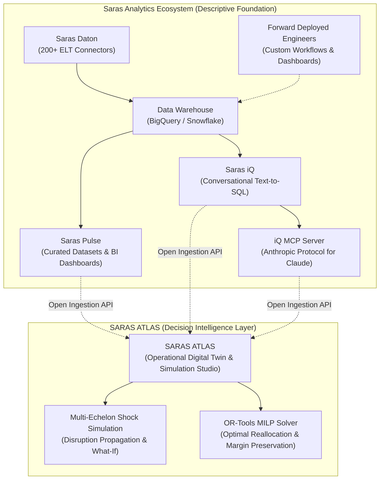

# SARAS ANALYTICS — PRODUCT CAPABILITY & ECOSYSTEM AUDIT

**Audit Date:** November 2, 2026  
**Auditor:** Senior Enterprise Architect & Autonomous CTO  
**Legal Notice:**  
*This audit is based exclusively on publicly available product documentation, company announcements, customer case studies, technical whitepapers, and market demonstrations. SARAS ATLAS is an independent innovation project. Saras Analytics has not commissioned, endorsed, reviewed, or granted private access to any proprietary systems or customer data. All company claims, customer metrics, and performance figures are cited directly from Saras Analytics publications and are labeled as "company-reported."*

---

## 1. Company Profile & Strategic Overview

**Saras Analytics** is an advanced data management and e-commerce intelligence company founded to provide high-growth direct-to-consumer (DTC), omnichannel, and retail brands with unified data pipelines, governed semantic data models, and conversational business intelligence.

The core company value proposition is resolving the acute **data fragmentation** that plagues multi-channel commerce brands—connecting disjointed data streams from Shopify, Amazon Seller Central, Meta Ads, Google Ads, TikTok, Klaviyo, ERPs (NetSuite), and third-party logistics (3PL) providers into centralized cloud data warehouses (Google BigQuery, Snowflake).

### Core Pillars of the Saras Ecosystem
1. **Saras Daton:** High-scale Extract, Load, Transform (ELT) pipeline infrastructure.
2. **Saras Pulse:** Governed master datasets and pre-built operational business intelligence dashboards.
3. **Saras iQ:** Conversational AI data analyst operating over a certified semantic layer.
4. **iQ MCP:** Enterprise implementation of Anthropic's Model Context Protocol bridging LLMs (Claude) with enterprise data warehouses.
5. **Forward Deployed Engineering (FDE):** High-agency embedded engineering services customizing and operationalizing client data stacks.



---

## 2. Exhaustive Audit of Saras Product Suite

### 2.1 Saras Daton
- **Primary Purpose:** Cloud-native automated ELT data integration pipeline.
- **Main Capabilities:**
  - Over 200 pre-built connectors spanning e-commerce storefronts (Shopify, Amazon, Magento, WooCommerce), ad networks (Meta, Google Ads, TikTok, Pinterest, Criteo), marketing automation (Klaviyo, Attentive, Postscript), subscription platforms (Recharge), ERPs (NetSuite), and 3PLs/WMS (ShipBob, Deliverr).
  - Automated schema replication, change-data-capture (CDC), incremental syncs, and historical backfills into Google BigQuery, Snowflake, Amazon Redshift, and Databricks.
  - Replaces manual API scripting and eliminates custom data engineering overhead.
- **AI/ML Features:** Automated anomaly detection in pipeline sync volumes and schema drift monitoring.
- **Data Engineering Capabilities:** Zero-maintenance automated ingestion, automated column type mapping, robust retry logic, and pipeline health observability.
- **Target Customers:** E-commerce data teams, marketing operations, and founders spending $> \$20\text{k}$/month across multiple ad platforms and sales channels.
- **Identified Boundaries / Gaps:** Daton is strictly an ingestion and sync mechanism. It does not perform predictive modeling, multi-echelon inventory balancing, or decision simulation.

### 2.2 Saras Pulse
- **Primary Purpose:** AI-ready data foundation and pre-built analytical reporting dashboards.
- **Main Capabilities:**
  - Governed, standardized data models out-of-the-box: Customer 360, Marketing Attribution (blended ROAS, CAC, MER), SKU-level Contribution Margin, Cohort Retention, and Inventory Turnover.
  - Pre-built executive, finance, and marketing dashboards in PowerBI, Looker Studio, and Tableau.
  - Certified metrics layer reconciling disparate data sources to an accuracy threshold reported within $\pm 1\%$.
- **AI/ML Features:** Basic trend forecasting, customer churn scoring, and LTV prediction models.
- **Business Problems Addressed:** Eliminates multi-week BI buildout times; standardizes business definitions so marketing, finance, and operations look at identical numbers.
- **Target Customers:** Heads of Growth, CMOs, CFOs, and business intelligence leads.
- **Identified Boundaries / Gaps:** Pulse reports *historical and current state* (e.g. "What was our contribution margin last week?", "Which SKUs are moving fastest?"). It lacks dynamic counterfactual simulation (e.g., "What will happen to our margin if shipping rates rise 28% and supplier X delays delivery by 21 days?").

### 2.3 Saras iQ
- **Primary Purpose:** Conversational AI e-commerce business analyst and natural language query interface.
- **Main Capabilities:**
  - Translates natural language questions ("What was our top grossing SKU in California last month after factoring in shipping costs?") into verified SQL queries.
  - Leverages a governed semantic layer containing company-specific business rules, metric formulas, and table mappings to prevent LLM hallucinations.
  - Returns deterministic answers, auto-generated visualization charts, and narrative text summaries with full transparency into the generated SQL.
- **AI/ML Features:** Natural Language Processing (NLP), semantic SQL generation, context-aware query reformulation, and automated data visualization synthesis.
- **Business Problems Addressed:** Eliminates the "analyst bottleneck" where business executives wait days for data teams to write custom SQL queries.
- **Identified Boundaries / Gaps:** Saras iQ functions primarily as a natural language query generator against retrospective warehouse tables. It is not designed to execute complex mathematical optimization algorithms (such as mixed-integer linear programming) or simulate multi-period network-wide supply chain disruptions.

### 2.4 Saras iQ MCP (Model Context Protocol)
- **Primary Purpose:** Enterprise MCP server bridging external AI models (specifically Anthropic's Claude) directly with the customer's governed data warehouse.
- **Main Capabilities:**
  - Solves the "raw database access problem" where direct LLM database connections lead to hallucinations, incorrect table joins, and flawed metric calculations.
  - Acts as a governed broker between Claude (via Claude Desktop, Team, or Enterprise) and the warehouse semantic layer.
  - Validates and restricts AI queries against certified metric catalogs (e.g. certified CAC, certified ROAS, certified Contribution Margin).
- **AI/ML Features:** Context injection, prompt grounding, tool exposure under the Model Context Protocol standard.
- **Target Customers:** AI-forward enterprise operators and data teams using Claude for daily business analysis.
- **Identified Boundaries / Gaps:** MCP is an architectural bridge/protocol, not a computational simulation engine. It allows Claude to *read* certified data, but does not simulate physical supply chain shocks or calculate multi-echelon network rebalancing.

### 2.5 Saras Forward Deployed Engineering (FDE)
- **Primary Purpose:** Embedded, high-agency technical consultancy that builds, customizes, and ships production data solutions directly within client enterprises.
- **Main Capabilities:**
  - High-touch engineering teams embedded inside client operations (acting as fractional data engineers, analytics engineers, and AI architects).
  - Extends native Saras products (Daton, Pulse, iQ) with bespoke data models, custom API integrations, and customized dashboard suites.
  - Serves as the primary product feedback engine for Saras, converting recurring client custom requirements into core platform features.
- **Target Customers:** Mid-market and enterprise brands with complex omnichannel footprints ($50M–$500M GMV) requiring tailored solutions without hiring an in-house 10-person data engineering team.

---

## 3. Published Customer Case Studies (Company-Reported Results)

| Client Brand | Industry / Category | Saras Solutions Deployed | Company-Reported Customer Outcome |
| :--- | :--- | :--- | :--- |
| **Faherty** | Premium Apparel & Lifestyle | Customer 360 Foundation, Carrier Analytics, Daton | *Reported saving $150K in shipping costs* during peak BFCM window using carrier state-level routing insights; achieved *sub-10% forecast error* on a ~$107M annual e-commerce target. |
| **Bare Performance Nutrition (BPN)** | Health, Wellness & Nutrition | Marketing Data Pipelines, Unified Reporting | *Reported significant revenue scaling* and media spend optimization through unified cross-channel marketing intelligence. |
| **Lansinoh** | Maternal & Baby Care Products | Data Pipeline Architecture, Warehouse Consolidation | *Reported cutting data stack infrastructure costs by 75%* through consolidated warehouse engineering. |
| **EPallet** | B2B Wholesale Marketplace | Daton ELT, Google Analytics 4 (GA4) Discrepancy Resolution | *Reported restoring 100% paid media tracking accuracy* and resolving critical GA4 cross-domain conversion tracking gaps. |
| **Decathlon** | Global Sporting Goods Retailer | Omnichannel Data Integration, Warehouse Analytics | *Reported unified omnichannel inventory and sales tracking* across retail doors and digital storefronts. |
| **True Classic** | Direct-to-Consumer Menswear | Marketing Attribution & Customer Intelligence | *Reported improved ad spend efficiency* and cross-platform media mix visibility. |
| **Murad** | Clinical Skincare | Advanced Financial & Contribution Margin Reporting | *Reported enhanced visibility into product-level profitability* and promotional discounts. |

*Note: All above outcomes represent company-reported metrics published in Saras Analytics marketing literature, public case studies, and partner announcements.*

---

## 4. Architectural Overlap & Differentiation Analysis

```
+---------------------------------------------------------------------------------+
|                              THE COMMERCE DATA CONTINUUM                        |
|                                                                                 |
|   PAST (What Happened?)   |   PRESENT (What Is?)   |   FUTURE (What IF We Act?) |
|   ---------------------   |   ------------------   |   ------------------------ |
|   * Daton (ELT sync)      |   * Pulse Dashboards   |   * SARAS ATLAS            |
|   * Historical Attribution|   * Saras iQ NLP query |   * Operational Twin       |
|   * Past Margin & ROAS    |   * Live Inventory DoC |   * Shock Propagation      |
|   * GA4 Reconciliation    |   * iQ MCP for Claude  |   * Counterfactual Sim     |
|                           |                        |   * OR-Tools Optimization  |
|                                                                                 |
|   [ SARAS ANALYTICS CORE SUITE ]                   | [ SARAS ATLAS INNOVATION ] |
+---------------------------------------------------------------------------------+
```

### 4.1 Direct Overlaps
1. **Core Data Entities:** Both platforms model commerce entities (Products, SKUs, Orders, Customers, Inventory Balances, Shipping Costs, Ad Spend).
2. **Metric Definitions:** Both platforms emphasize SKU-level Contribution Margin, Customer Acquisition Cost (CAC), and inventory turnover.
3. **AI Interface Philosophy:** Both recognize that business users prefer natural language interactions over writing SQL or navigating bloated static dashboards.

### 4.2 The Innovation Chasm (Where Saras Stops and ATLAS Begins)
1. **Descriptive vs Prescriptive:** Saras informs leadership of current or past reality (e.g. "Your inventory at the West Coast 3PL is 1,200 units"). ATLAS simulates the downstream chain reaction (e.g. "Your West Coast inventory will stock out in 9 days; fulfilling from East Coast will inflate fulfillment costs by 48%; air-freighting 600 units now from backup supplier will save $24,000 in net margin").
2. **Unconstrained vs Multi-Echelon Network Flow:** Saras dashboards treat warehouse locations as isolated metric dimensions. ATLAS models the entire supply chain as a directed multigraph with lead-time physics, transit constraints, transfer costs, and carrier zone tariffs.
3. **Mathematical Decision Optimization:** Saras has no mixed-integer linear programming (MILP) or operations research engine. ATLAS incorporates Google OR-Tools to solve complex, multi-variable allocation problems under hard capital and service-level constraints.

---

## 5. Potential for High-Value Integration & Partnership

If deployed alongside Saras Analytics, SARAS ATLAS would represent the premier decision engine atop the Saras data stack:
- **Daton as the Source of Truth:** ATLAS consumes Daton-ingested warehouse tables directly, bypassing weeks of custom API integration.
- **Pulse as the Semantic Anchor:** ATLAS anchors all financial formulas directly to Saras Pulse's certified contribution margin logic.
- **iQ MCP as the Natural Language Channel:** ATLAS exposes its simulation tools (`run_scenario_simulation`, `optimize_mitigation_plan`) to the Saras iQ MCP server, allowing an executive chatting with Claude to say:  
  *"Claude, run a simulation: what happens if our Vietnam supplier is delayed 18 days?"*  
  And Claude invokes SARAS ATLAS in the background, returning a verified, mathematically sound decision scorecard.
