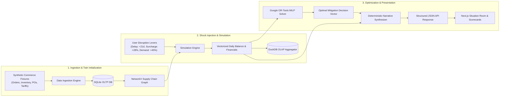

# SYSTEM ARCHITECTURE SPECIFICATION

**Document ID:** ARCH-ATLAS-001  
**Version:** 1.0.0  
**Phase:** Phase 0 Baseline  
**Author:** Senior Enterprise Architect & Autonomous CTO  

---

## 1. Architectural Philosophy & Guiding Principles

SARAS ATLAS is architected to deliver enterprise-grade performance, mathematical precision, and absolute auditability while strictly adhering to three constraints:
1. **Zero Financial Budget (₹0):** Engineered exclusively with battle-tested, permissively licensed open-source technologies (MIT, Apache 2.0, BSD).
2. **Hardware Boundedness (8.0 GB RAM Host Target):** Operates within an ultra-lean memory envelope ($\le 1.0\text{ GB}$ total RAM across frontend and backend), avoiding resource contention and virtual memory paging on the host computer.
3. **Deterministic Core:** Every financial projection, inventory balance, and optimization recommendation is computed via verified mathematical algorithms. Language models are never used for arithmetic or constraint evaluation.

---

## 2. High-Level System Architecture (Modular Monolith)

SARAS ATLAS rejects premature microservice decomposition in favor of a cohesive, high-performance **Modular Monolith**. 

```mermaid
flowchart TB
    subgraph Client_Layer["Frontend Presentation Tier (Next.js 15 / React 19 / TypeScript)"]
        UI_SR["Executive Situation Room<br/>(KPI Cards, Stockout Horizon)"]
        UI_NET["Network Topology Map<br/>(Interactive SVG / ReactFlow)"]
        UI_SIM["Scenario Simulation Studio<br/>(Parametric Sliders & Delta Tables)"]
        UI_OPT["Decision Optimization Center<br/>(Pareto Frontier & Action Plan)"]
        UI_GOV["Governance & Approval Modal<br/>(Audit Trails & Two-Man Sign-Off)"]
    end

    subgraph API_Layer["Application & Ingestion Tier (FastAPI / Pydantic v2)"]
        GW["REST API Gateway & Pydantic Validation"]
        AUTH["Local Role-Based Access Control (RBAC)"]
        MCP_ADAPTER["Anthropic Model Context Protocol (MCP) Adapter"]
    end

    subgraph Domain_Core["Domain Computation Core (Python 3.12 Engine)"]
        TWIN["1. Digital Twin State Manager<br/>(Multi-Echelon Network Graph - NetworkX)"]
        RISK["2. Sentinel Risk Detection Engine<br/>(Lead-Time Variance & Coverage Rules)"]
        SIM["3. Impact Propagation Engine<br/>(Multi-Period Balance & Out-of-Zone Rerouting)"]
        FORECAST["4. Baseline Demand Forecaster<br/>(Statsmodels Holt-Winters / Elasticity)"]
        SOLVER["5. Prescriptive Optimization Engine<br/>(Google OR-Tools MILP Solver)"]
        EXPLAIN["6. Deterministic Narrative Synthesizer<br/>(Variance Decomposition & Briefing Generator)"]
    end

    subgraph Data_Layer["Storage & Analytical Tier (In-Process Hybrid)"]
        SQLITE[("Operational Store (OLTP)<br/>SQLite 3 (WAL Mode)<br/>SQLAlchemy 2.0 ORM")]
        DUCKDB[("Analytical Engine (OLAP)<br/>Embedded DuckDB<br/>Vectorized Scenario Analytics")]
        FILES["Synthetic Data & Fixture Parquet Repository"]
    end

    Client_Layer <-->|Async JSON over HTTP / OpenAPI| API_Layer
    API_Layer <--> Domain_Core
    Domain_Core <--> Data_Layer
```

---

## 3. Detailed Component Architecture

### 3.1 Frontend Presentation Tier (Next.js 15 App Router)
- **Framework:** Next.js 15.0+ running on Node.js v24.15.0.
- **Rendering Model:** Hybrid architecture: Server Components (RSC) for initial high-speed layout rendering; Client Components (`"use client"`) for real-time scenario simulation sliders, interactive charts, and modal dialogs.
- **Styling & Components:** Tailwind CSS combined with Radix UI headless primitives (accessible, screen-reader compliant, keyboard navigable).
- **Visualization Suite:**
  - *Recharts:* Multi-line inventory projection charts, contribution margin waterfalls, and working capital burn trajectories.
  - *Interactive Network Graph:* SVG/Canvas-based node-and-edge visualization rendering suppliers, maritime transit vessels, distribution centers, and regional delivery zones with dynamic color-coded health indicators.
- **Client State Management:** Zustand (1 KB footprint) for managing active scenario parameters, shock levers, and side-by-side comparison states.

### 3.2 Application & API Gateway (FastAPI + Pydantic v2)
- **Framework:** FastAPI running via Uvicorn on Python 3.12.
- **Schema Contracts:** All API request bodies and responses are defined using strictly typed Pydantic v2 models, compiled via Rust for sub-millisecond serialization.
- **OpenAPI Integration:** Automated Swagger and Redoc generation at `/docs` and `/redoc`.
- **MCP Tool Exposure:** Dedicated endpoints formatted to Anthropic's Model Context Protocol (MCP) specification, enabling safe, sandboxed invocation by external conversational agents (like Claude or Saras iQ).

### 3.3 Domain Computation Core
1. **Digital Twin State Manager:** Maintains an in-memory directed multigraph $G=(V, E)$ using `NetworkX`. Nodes represent Suppliers, Transit Hubs, Warehouses, and Customer Zones. Edges represent transportation lanes with transit-time probability distributions and carrier rate cards.
2. **Sentinel Risk Detection Engine:** Continuously monitors inventory snapshots against forward-looking replenishment schedules. Calculates Days of Coverage ($DoC$) and flags bottleneck thresholds.
3. **Impact Propagation Engine:** Implements vectorized difference equations simulating daily inventory inflows, outflows, safety stock breaches, cross-zone fallback fulfillment, and daily financial statements.
4. **Demand Forecasting Engine:** Provides statistical baselines using `statsmodels` (Holt-Winters Exponential Smoothing) with seasonal adjustments and parametric demand elasticity multipliers.
5. **Prescriptive Optimization Engine:** Encapsulates Google OR-Tools Mixed-Integer Linear Programming (MILP) solvers (CBC / SCIP) to determine optimal multi-node transfer quantities, emergency air freight splits, and ad spend throttling factors.
6. **Deterministic Narrative Synthesizer:** Decomposes scenario variance into component effects (Volume Effect, Freight Rate Effect, Cross-Zone Penalty, Lost Margin) and generates executive briefs without calling paid LLMs.

### 3.4 In-Process Dual Storage Tier (ADR-001)
- **Operational Store (OLTP):** SQLite 3.45+ configured with:
  - `PRAGMA journal_mode = WAL;` (Concurrent readers without blocking writers).
  - `PRAGMA synchronous = NORMAL;` (High durability with minimal disk I/O overhead).
  - `PRAGMA foreign_keys = ON;` (Strict relational referential integrity).
  - Abstracted through SQLAlchemy 2.0 ORM with Alembic migrations, ensuring 100% dialect portability to PostgreSQL for future cloud deployment.
- **Analytical Store (OLAP):** Embedded `DuckDB` instance querying columnar Parquet files for high-throughput aggregations across multi-scenario runs.

---

## 4. End-to-End Data Flow

---

## 5. Security & Isolation Boundaries

1. **Localhost Network Binding:** All API services bind strictly to `127.0.0.1`, completely preventing unauthorized remote network ingress.
2. **Read-Only Baseline Isolation:** Baseline operational data is strictly read-only during simulations. All scenario evaluations operate on immutable in-memory clones, preventing accidental corruption of production state.
3. **No Autonomous Financial Transactions:** The platform provides zero integration pathways to banking APIs, automated wire transfers, or live external supplier ordering systems. All recommendations require authenticated human approval.
4. **Sub-Second Fail-Safe Timeouts:** Optimization solver execution is bounded by a hard 5.0-second timeout, guaranteeing that complex combinatorial searches never hang the application.

---

## 6. Resource Budget & Memory Footprint

| Subsystem | Resident Memory (RSS) | CPU Utilization (Idle) | CPU Utilization (Peak Simulation) |
| :--- | :--- | :--- | :--- |
| **Backend Core (Python 3.12 / FastAPI)** | $\sim 180\text{ MB}$ | $< 0.1\%$ | $\sim 25\%$ (Multi-core NumPy/OR-Tools) |
| **Embedded Storage (SQLite + DuckDB)** | $\sim 45\text{ MB}$ | $0.0\%$ | $\sim 10\%$ (Vectorized scan) |
| **Frontend Server (Next.js Dev Server)** | $\sim 160\text{ MB}$ | $< 0.1\%$ | $\sim 15\%$ (Initial compilation) |
| **Client Browser Execution (Chromium)** | $\sim 120\text{ MB}$ | $< 0.5\%$ | $\sim 5\%$ (SVG Rendering) |
| **Total System Footprint** | **$\sim 505\text{ MB}$** | **$< 1.0\%$** | **$\le 55\%$ (Bursts $< 200\text{ ms}$)** |

**Conclusion:** The architecture operates comfortably within the host machine's 1.73 GB free memory headroom, preserving system stability and eliminating disk swap thrashing.

